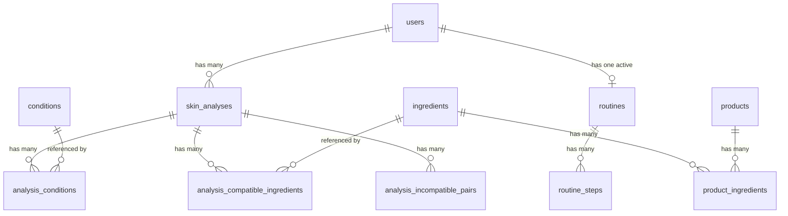

# AureSkin — Technical View
### Part 2 of 2: Technical Architecture & Implementation

> [!NOTE]
> This is the **modified version** of Part 2, incorporating backend architecture patterns adopted from the [Backend Skills Analysis](file:///C:/Users/Thea/.gemini/antigravity-ide/brain/692cc3d4-d836-48b9-a525-3768c52e382f/backend_skills_analysis.md). Changes are concentrated in the **Backend Architecture** section — the frontend, database, auth, and deployment sections remain the same as the original.

---

## Table of Contents

1. [Tech Stack Summary](#tech-stack-summary)
2. [System Architecture](#system-architecture)
3. [Algorithms Used](#algorithms-used)
4. [Frontend Architecture (MVVM)](#frontend-architecture-mvvm)
5. [Backend Architecture (FastAPI)](#backend-architecture-fastapi)
6. [Backend Engineering Standards](#backend-engineering-standards)
7. [Database Design (Supabase / PostgreSQL)](#database-design)
8. [Authentication Flow](#authentication-flow)
9. [API Endpoints](#api-endpoints)
10. [Deployment & Hosting](#deployment--hosting)

---

## Tech Stack Summary

### 1. Frontend Architecture
| Layer / Category       | Technology                         | Purpose                                                              |
|------------------------|------------------------------------|----------------------------------------------------------------------|
| **Core Framework**     | React Native + Expo                | Cross-platform mobile app (iOS & Android)                            |
| **Styling & Theming**  | NativeWind + Expo Appearance API   | Utility-first styling (Tailwind CSS) & system theme detection        |
| **UI Components**      | React Native Reusables (RNR)       | Unstyled, customizable UI primitives (Radix/shadcn equivalent)       |
| **Icons**              | lucide-react-native                | Vector icons with highly customizable styling                        |
| **Notifications**      | react-native-toast-message         | In-app feedback toasts & banners                                     |
| **Push Notifications** | expo-notifications                 | Background push notifications            |
| **Navigation**         | React Navigation (Stack + Tab)     | Screen routing                                                       |
| **State Management**   | Zustand                            | Lightweight global state                                             |
| **Data Fetching**      | React Query (TanStack Query)       | Async server state, caching                                          |
| **Camera / Media**     | Expo Camera, Expo Image Picker     | Image capture & upload                                               |

### 2. Backend Architecture
| Layer / Category       | Technology                         | Purpose                                                              |
|------------------------|------------------------------------|----------------------------------------------------------------------|
| **Core Framework**     | FastAPI (Python 3.11+)             | REST API + ML inference server                                       |
| **ASGI Server**        | Uvicorn                            | High-performance async server                                        |
| **Logging**            | Loguru                             | Structured request & error logging                                   |
| **Rate Limiting**      | SlowAPI                            | Protect expensive ML endpoints                                       |

### 3. Machine Learning & Algorithms
| Layer / Category       | Technology                         | Purpose                                                              |
|------------------------|------------------------------------|----------------------------------------------------------------------|
| **ML Framework**       | TensorFlow / Keras                 | Run `.keras` models directly                                         |
| **Face Landmark Mesh** | MediaPipe Face Mesh                | 468-point 3D facial landmark detection for anatomical zone cropping |
| **Image Processing**   | OpenCV (cv2), Pillow               | Normalization, tensor transformations, and image resizing            |
| **Health Scoring**     | Weighted Heuristic Algorithm       | Computes overall skin health score (0–100) based on condition severity |
| **Compatibility Check**| Rule-Based Relational Lookup       | Match active ingredients against harmful_pairs knowledge base        |

### 4. Database & Infrastructure
| Layer / Category       | Technology                         | Purpose                                                              |
|------------------------|------------------------------------|----------------------------------------------------------------------|
| **Database**           | Supabase (PostgreSQL)              | Relational data storage                                              |
| **Auth**               | Supabase Auth                      | JWT-based user authentication                                        |
| **File Storage**       | Supabase Storage                   | User face images, product photos, avatars                            |
| **Hosting (Backend)**  | Railway.app                        | Python backend deployment                                            |
| **Hosting (Mobile)**   | Expo EAS Build                     | `.apk` / `.ipa` distribution                                         |

<!-- 
| Layer | Technology | Purpose |
|---|---|---|
| **Frontend** | React Native + Expo | Cross-platform mobile app (iOS & Android) |
| **Styling** | NativeWind (Tailwind CSS for RN) | Utility-first styling |
| **Navigation** | React Navigation (Stack + Bottom Tab) | Screen routing |
| **State Management** | Zustand | Lightweight global state |
| **Data Fetching** | React Query (TanStack Query) | Async server state, caching |
| **Camera / Media** | Expo Camera, Expo Image Picker | Image capture & upload |
| **Backend** | FastAPI (Python 3.11+) | REST API + ML inference server |
| **ASGI Server** | Uvicorn | High-performance async server |
| **ML Framework** | TensorFlow / Keras | Run `.keras` models directly |
| **Image Processing** | OpenCV (cv2), Pillow | Preprocessing for ML models |
| **OCR** | EasyOCR | Extract text from product labels |
| **NLP** | scikit-learn (TF-IDF, Cosine Similarity) | Ingredient compatibility analysis |
| **Database** | Supabase (PostgreSQL) | Relational data storage |
| **Auth** | Supabase Auth | JWT-based user authentication |
| **File Storage** | Supabase Storage | User face images, product photos |
| **Logging** | Loguru | Structured request & error logging |
| **Rate Limiting** | SlowAPI | Protect expensive ML endpoints |
| **Hosting (Backend)** | Railway.app or Render | Python backend deployment |
| **Hosting (Mobile)** | Expo EAS Build | `.apk` / `.ipa` distribution | -->

---

## System Architecture

```
┌─────────────────────────────────────────────────┐
│              REACT NATIVE (EXPO)                │
│                                                 │
│  ┌───────────┐  ┌──────────┐  ┌──────────────┐  │
│  │  Zustand  │  │  React   │  │ Expo Camera  │  │
│  │  (State)  │  │  Query   │  │ Image Picker │  │
│  └───────────┘  └──────────┘  └──────────────┘  │
│                                                 │
│  ┌─────────────────────────────────────────┐    │
│  │  React Navigation (Bottom Tab + Stack)  │    │
│  │                                         │    │
│  │  Home ─ Library ─ Scan ─ History ─ Rtn  │    │
│  └─────────────────────────────────────────┘    │
│                                                 │
│  MVVM Architecture:                             │
│  View → ViewModel (hooks) → Model (API/types)   │
└───────────────────────┬─────────────────────────┘
                        │
                        │  REST API (HTTPS + JSON)
                        │  + Multipart (image upload)
                        ▼
┌─────────────────────────────────────────────────┐
│              FASTAPI (PYTHON)                   │
│                                                 │
│  ┌───────────────────────────────────────────┐  │
│  │  core/  (Cross-Cutting Concerns)          │  │
│  │  ┌──────────┐ ┌───────────┐ ┌──────────┐  │  │
│  │  │ security │ │ responses │ │ logging  │  │  │
│  │  │ (JWT)    │ │ (standard)│ │ (loguru) │  │  │
│  │  └──────────┘ └───────────┘ └──────────┘  │  │
│  │  ┌──────────┐ ┌───────────┐ ┌──────────┐  │  │
│  │  │exceptions│ │pagination │ │rate_limit│  │  │
│  │  │(AppError)│ │(limit/ofs)│ │(SlowAPI) │  │  │
│  │  └──────────┘ └───────────┘ └──────────┘  │  │
│  │  ┌─────────────────────────────────────┐  │  │
│  │  │ supabase_client (DB/Storage client) │  │  │
│  │  └─────────────────────────────────────┘  │  │
│  └───────────────────────────────────────────┘  │
│                                                 │
│  ┌───────────────────────────────────────────┐  │
│  │  features/  (Feature-Driven Grouping)     │  │
│  │                                           │  │
│  │  scan/        → router, service, schemas, │  │
│  │  ingredients/    repository               │  │
│  │  products/                                │  │
│  │  history/     Each feature is self-       │  │
│  │  routine/     contained with its own      │  │
│  │  articles/    4-layer stack               │  │
│  │  profile/     (Auth is client-to-Supabase)│  │
│  └────────────────────┬──────────────────────┘  │
│                       ▼                         │
│  ┌───────────────────────────────────────────┐  │
│  │         ML & Inference Layer              │  │
│  │  MediaPipe Face Mesh (468 Landmarks)      │  │
│  │  MobileNetV3 Skin Type Model (.keras)     │  │
│  │  MobileNetV3 Skin Condition Model (.keras)│  │
│  │  Weighted Heuristic Health Scorer         │  │
│  │  Rule-Based Harmful Pairs Matcher         │  │
│  └───────────────────────────────────────────┘  │
└───────────────┬─────────────────────────┬───────┘
                │                         │      
                ▼                         ▼      
┌──────────────────────────────────┐ ┌──────────────────────────┐
│       Supabase PostgreSQL        │ │    Supabase Storage      │
│                                  │ │                          │
│  analysis_compatible_ingredients │ │  /face-images/{user_id}/ │
│  analysis_conditions             │ │  /product-images/        │
│  analysis_incompatible_pairs     │ │  /avatars/               │
│  articles                        │ └──────────────────────────┘
│  conditions                      │
│  harmful_pairs                   │
│  ingredients                     │
│  product_ingredients             │
│  products                        │
│  routine_steps                   │
│  routines                        │
│  skin_analyses                   │
│  skin_types                      │
│  users                           │
└──────────────────────────────────┘
```

---

## Algorithms Used

AureSkin uses six core algorithms across its features. This section provides a summary of each. For full mathematical representations, pseudocode, and time complexity analysis, see [`thesis_section_3_3_1.md`](file:///c:/Users/Thea/Documents/DLSUD/BCS34/AureSkin/documentation/thesis_section_3_3_1.md).

### Algorithm-to-Feature Mapping

| Algorithm | Feature It Powers | What It Does |
|---|---|---|
| **MediaPipe Face Mesh (BlazeFace + 3D Landmark CNN)** | Skin Analysis Preprocessing | Detects 468 3D facial landmarks to dynamically crop anatomical T-zone, left cheek, and right cheek regardless of head tilt, scale, or distance |
| **Image Preprocessing (OpenCV)** | Skin Analysis | Standardizes raw face photos to a fixed size, color space, and normalization for the ML models |
| **MobileNetV3 — Skin Type** | Skin Analysis | Multi-class CNN that classifies the face into 1 of 5 skin types using zone-based input (T-zone, left cheek, right cheek) |
| **MobileNetV3 — Skin Condition** | Skin Analysis | Multi-label CNN that detects 0–8 skin conditions from the full face image |
| **Weighted Heuristic Scoring Algorithm** | Skin Analysis (Health Score) | Calculates a standardized 0–100 skin health score by weighting detected conditions, their confidence levels, and skin type stability against a baseline score of 100 |
| **Rule-Based Conflict Matching** | Ingredient Compatibility | Evaluates user-compatible ingredients against the `harmful_pairs` knowledge base table to flag dangerous interactions without vectorization overhead |
| **Content-Based Filtering** | Routine Generation | Matches user skin profile and detected conditions to product features to recommend tailored morning and evening routine steps (customizable and swappable) |

### Model Summary

| Model | File | Input | Output | Activation | Loss |
|---|---|---|---|---|---|
| Skin Type | `aureskin_type_v3.keras` | 3 zone crops (112×112 each) | 1 of 5 classes | Softmax | Categorical Crossentropy |
| Skin Condition | `aureskin_condition_v2.keras` | Full face (224×224) | 0–8 conditions | Sigmoid | Binary Crossentropy |

Both models use **MobileNetV3Large** as the backbone, initialized with ImageNet weights and fine-tuned in two phases (frozen warm-up → full fine-tuning).

---

## Frontend Architecture (MVVM)

The React Native frontend follows the **Model–View–ViewModel (MVVM)** pattern. Each page/feature is self-contained with its own model, viewmodel, and view layers.

> [!IMPORTANT]
> **MVVM Role Summary:**
> - **Model** → Data layer: TypeScript types, API calls, mock data
> - **ViewModel** → Logic layer: React hooks that connect Model to View
> - **View** → UI layer: React Native components the user sees and interacts with

### Complete Frontend File Tree

```
src/
│
├── app/                                    ← Expo Router entry point
│   ├── _layout.tsx                         ← Root layout (providers, auth guard)
│   ├── (auth)/                             ← Auth screens group
│   │   ├── login.tsx
│   │   └── register.tsx
│   └── (tabs)/                             ← Bottom tab navigator group
│       ├── _layout.tsx                     ← Tab bar configuration
│       ├── index.tsx                       ← Home tab entry
│       ├── library.tsx                     ← Library tab entry
│       ├── scan.tsx                        ← Scan tab entry
│       ├── history.tsx                     ← History tab entry
│       └── routine.tsx                     ← Routine tab entry
│
├── shared/
│   ├── components/                         ← Global reusable UI components
│   │   ├── Button.tsx
│   │   ├── Card.tsx
│   │   ├── TabSwitcher.tsx
│   │   ├── SearchBar.tsx
│   │   ├── LoadingSpinner.tsx
│   │   ├── EmptyState.tsx
│   │   ├── BottomSheet.tsx
│   │   └── Avatar.tsx
│   │
│   ├── hooks/                              ← Global shared hooks
│   │   ├── useAuth.ts                      ← Auth state & actions
│   │   └── useSupabase.ts                  ← Supabase client hook
│   │
│   ├── services/                           ← Global API client config
│   │   ├── api.ts                          ← Axios/fetch instance, base URL, interceptors
│   │   └── supabase.ts                     ← Supabase client initialization
│   │
│   ├── store/                              ← Zustand global stores
│   │   ├── authStore.ts                    ← User session state
│   │   └── appStore.ts                     ← App-wide UI state
│   │
│   ├── types/                              ← Shared TypeScript types
│   │   └── common.ts                       ← Common types used across features
│   │
│   └── utils/                              ← Utility functions
│       ├── formatDate.ts
│       └── imageHelpers.ts
│
└── features/
    │
    ├── auth/
    │   ├── model/
    │   │   ├── auth_types.ts               ← Auth credentials, token responses
    │   │   └── auth_api.ts                 ← login(), register(), refresh()
    │   │
    │   ├── viewmodel/
    │   │   └── useAuth.ts                  ← Auth state, loading states, form validation
    │   │
    │   └── view/
    │       ├── LoginPage.tsx               ← Main login screen
    │       ├── RegisterPage.tsx            ← Registration screen
    │       ├── TermsPage.tsx               ← Terms and conditions screen
    │       └── components/                 
    │           ├── AuthCard.tsx
    │           ├── AuthInput.tsx
    │           ├── AuthButton.tsx
    │           └── OAuthButton.tsx
    │
    ├── home/
    │   ├── model/
    │   │   ├── home_types.ts               ← LatestAnalysis, RoutineStep, Article, FAQ types
    │   │   ├── home_api.ts                 ← fetchLatestAnalysis(), fetchTodayRoutine(), fetchArticles()
    │   │   ├── home_faqs.ts                ← [HARDCODED] Static skincare FAQs & test guidance
    │   │   └── home_mock.ts                ← Mock data for dev
    │   │
    │   ├── viewmodel/
    │   │   └── useHome.ts                  ← Orchestrates all home data queries
    │   │
    │   └── view/
    │       ├── HomePage.tsx                ← Entry point, layout shell
    │       ├── containers/
    │       │   ├── s1_LatestAnalysis.tsx    ← Latest scan result card
    │       │   ├── s2_TodayRoutine.tsx      ← Today's routine steps
    │       │   ├── s3_SkinTestGuide.tsx     ← Scan tip section
    │       │   ├── s4_Articles.tsx          ← Skincare articles list
    │       │   └── s5_FAQs.tsx             ← Frequently asked questions
    │       └── components/
    │           ├── AnalysisSummaryCard.tsx
    │           ├── RoutineStepItem.tsx
    │           ├── ArticleCard.tsx
    │           └── FAQItem.tsx
    │
    ├── library/
    │   ├── model/
    │   │   ├── library_types.ts            ← Ingredient, Product types
    │   │   ├── library_api.ts              ← fetchIngredients(), fetchProducts(),
    │   │   │                                  addProduct(), fetchIngredientById(),
    │   │   │                                  fetchProductById()
    │   │   └── library_mock.ts
    │   │
    │   ├── viewmodel/
    │   │   ├── useIngredients.ts            ← Ingredient list, search, pagination
    │   │   ├── useProducts.ts              ← Product list, search, pagination
    │   │   └── useAddProduct.ts            ← Add-new-product form state + submission
    │   │
    │   └── view/
    │       ├── LibraryPage.tsx             ← Entry point with Ingredients/Products tab switcher
    │       ├── containers/
    │       │   ├── s1_IngredientsTab.tsx    ← Ingredients list tab content
    │       │   └── s2_ProductsTab.tsx       ← Products list tab content
    │       └── components/
    │           ├── IngredientListItem.tsx
    │           ├── ProductListItem.tsx
    │           ├── IngredientDetailPage.tsx  ← Full ingredient detail (navigated to)
    │           ├── ProductDetailPage.tsx     ← Full product detail (navigated to)
    │           └── AddProductForm.tsx        ← Manual product entry (name, brand, category, ingredients)
    │
    ├── scan/
    │   ├── model/
    │   │   ├── scan_types.ts               ← ScanResult, HealthScore, SkinType, SkinCondition,
    │   │   │                                  CompatibleIngredient, IncompatiblePair types
    │   │   ├── scan_api.ts                 ← uploadScan(image), fetchCompatibility(analysisId)
    │   │   └── scan_mock.ts
    │   │
    │   ├── viewmodel/
    │   │   ├── useScan.ts                  ← Camera/gallery image capture, upload trigger
    │   │   └── useScanResults.ts           ← Results (type, conditions, health score) + compatibility data fetching
    │   │
    │   └── view/
    │       ├── ScanPage.tsx                ← Entry point: camera/upload UI
    │       ├── containers/
    │       │   ├── s1_ImageCapture.tsx      ← Camera preview + gallery picker
    │       │   ├── s2_ResultsTab.tsx        ← Health score, skin type, conditions, summary
    │       │   └── s3_CompatibilityTab.tsx  ← Compatible + incompatible ingredients
    │       └── components/
    │           ├── CameraPreview.tsx
    │           ├── HealthScoreCard.tsx      ← Visual 0–100 health score meter
    │           ├── SkinTypeCard.tsx
    │           ├── ConditionBadge.tsx
    │           ├── AnalysisSummary.tsx
    │           ├── CompatibleIngredientItem.tsx
    │           └── IncompatiblePairItem.tsx
    │
    ├── history/
    │   ├── model/
    │   │   ├── history_types.ts            ← HistoryEntry, HistoryDetail types
    │   │   ├── history_api.ts              ← fetchHistory(), fetchHistoryDetail(id),
    │   │   │                                  deleteHistoryEntry(id)
    │   │   └── history_mock.ts
    │   │
    │   ├── viewmodel/
    │   │   ├── useHistory.ts               ← History list, pagination, delete
    │   │   └── useHistoryDetail.ts         ← Single past analysis detail
    │   │
    │   └── view/
    │       ├── HistoryPage.tsx             ← Entry point: scrollable list of past scans
    │       ├── containers/
    │       │   └── s1_HistoryList.tsx       ← Row list of saved analyses
    │       └── components/
    │           ├── HistoryListItem.tsx
    │           └── HistoryDetailPage.tsx    ← Full detail view (navigated to)
    │
    ├── routine/
    │   ├── model/
    │   │   ├── routine_types.ts            ← Routine, RoutineStep types (morning & night)
    │   │   ├── routine_api.ts              ← fetchRoutine(), generateRoutine(), updateRoutineStep()
    │   │   └── routine_mock.ts
    │   │
    │   ├── viewmodel/
    │   │   └── useRoutine.ts               ← Routine state, step customization, product swapping
    │   │
    │   └── view/
    │       ├── RoutinePage.tsx             ← Entry point: morning/night static tabs or generate button
    │       ├── containers/
    │       │   ├── s1_EmptyRoutine.tsx      ← "Generate Routine" prompt (no routine yet)
    │       │   └── s2_RoutineSteps.tsx      ← Step-by-step routine display (with edit/swap options)
    │       └── components/
    │           ├── RoutineStepCard.tsx     ← Step card with swappable product display
    │           └── SwapProductSheet.tsx    ← Modal to choose alternative product from library
    │
    └── profile/
        ├── model/
        │   ├── profile_types.ts            ← UserProfile type
        │   ├── profile_api.ts              ← fetchProfile(), updateProfile()
        │   └── profile_mock.ts
        │
        ├── viewmodel/
        │   └── useProfile.ts               ← Profile data, edit state
        │
        └── view/
            ├── ProfilePage.tsx             ← User profile screen (accessible from header/settings)
            └── components/
                └── ProfileForm.tsx
```

### MVVM Data Flow (Per Feature)

```
┌─────────────────────────────────────────────────────────┐
│  VIEW (React Native Components)                         │
│  HomePage.tsx / ScanPage.tsx / ...                      │
│                                                         │
│  Renders UI using data + actions from ViewModel         │
│  User interactions (tap, input) → call ViewModel fns    │
└─────────────────────────┬───────────────────────────────┘
                          │  calls hook
                          ▼
┌─────────────────────────────────────────────────────────┐
│  VIEWMODEL (Custom React Hook)                          │
│  useHome.ts / useScan.ts / ...                          │
│                                                         │
│  - Uses React Query to call API functions               │
│  - Manages loading / error / success states             │
│  - Transforms raw API data into view-ready format       │
│  - Exposes: { data, isLoading, error, actions }         │
└─────────────────────────┬───────────────────────────────┘
                          │  calls API function
                          ▼
┌─────────────────────────────────────────────────────────┐
│  MODEL (Data Layer)                                     │
│  home_api.ts / scan_api.ts / ...                        │
│                                                         │
│  - TypeScript interfaces define shape of data           │
│  - API functions make HTTP requests to FastAPI backend  │
│  - Mock files provide fake data during development      │
└─────────────────────────────────────────────────────────┘
```

### Design Tokens & Theme Configuration Files

- **`tailwind.config.js`** — `frontend/tailwind.config.js` — Defines compile-time design tokens (colors, font families, font sizes, and border radius presets) for NativeWind/Tailwind utility classes used across JSX components.
- **`index.ts`** — `frontend/src/shared/theme/index.ts` — Exports runtime TypeScript constants (raw hex color codes) used for imperative styling where utility classes cannot be applied (e.g., vector icons, SVGs, circular health gauge, and native navigation header tints).

---

## Backend Architecture (FastAPI)

The backend follows a **feature-driven layered architecture** with strict separation of concerns. Each feature is self-contained with its own 4-layer stack (Router → Service → Repository → Schemas), and cross-cutting concerns live in a centralized `core/` directory.

> [!IMPORTANT]
> **Backend Layer Responsibilities (4-Layer Pattern):**
> - **Router** → Defines API endpoints, attaches middleware (auth, rate limits), maps requests to the service
> - **Service** → All business logic, ML orchestration, third-party API calls. No direct DB access.
> - **Repository** → The *only* layer that talks to the database. All Supabase queries and mutations live here.
> - **Schemas** → Pydantic models that validate request bodies and shape response output. Acts as the contract between frontend and backend.

### Complete Backend File Tree

```
backend/
│
├── main.py                                 ← FastAPI app entry point, lifespan events,
│                                              global exception handlers, middleware registration
├── config.py                               ← Pydantic Settings: validates env vars on startup
├── requirements.txt                        ← Python dependencies
├── .env                                    ← Secrets (DB URL, JWT secret, etc.)
│
├── core/                                   ← Cross-cutting concerns (shared across all features)
│   ├── __init__.py
│   │
│   ├── supabase_client.py                  ← Supabase Python client initialization
│   │                                          Exposes: get_supabase() dependency
│   │
│   ├── security.py                         ← JWT validation against Supabase public keys
│   │                                          Exposes: get_current_user() dependency
│   │                                          Returns user_id from validated JWT
│   │
│   ├── exceptions.py                       ← [NEW] AppError base class + specific subclasses
│   │                                          ValidationError (400)
│   │                                          UnauthorizedError (401)
│   │                                          ForbiddenError (403)
│   │                                          NotFoundError (404)
│   │                                          ConflictError (409)
│   │                                          InternalError (500)
│   │
│   ├── responses.py                        ← [NEW] Standardized response wrappers
│   │                                          success_response(data, message, meta)
│   │                                          error_response(code, message, details)
│   │
│   ├── logging.py                          ← [NEW] Loguru configuration
│   │                                          Structured JSON logging
│   │                                          Request logging middleware (method, path, status, duration)
│   │                                          Error tracking with context
│   │
│   ├── rate_limiter.py                     ← [NEW] SlowAPI setup
│   │                                          Strict limits for /scan (ML inference)
│   │                                          Standard limits for other endpoints
│   │
│   └── pagination.py                       ← [NEW] Reusable pagination utilities
│                                              PaginationParams (limit, offset query params)
│                                              PaginatedResponse schema (data, total, page, pages)
│
├── models/                                 ← ML model files (loaded at startup)
│   ├── aureskin_type_v3.keras
│   └── aureskin_condition_v2.keras
│
├── ml/                                     ← ML & inference layer
│   ├── __init__.py
│   ├── loader.py                           ← Load .keras models into memory at startup
│   ├── preprocessor.py                     ← Image preprocessing (resize, normalize) + MediaPipe Face Mesh zone extraction (112×112)
│   ├── skin_type_classifier.py             ← Run skin type model, return predictions
│   ├── skin_condition_classifier.py        ← Run skin condition model, return predictions
│   ├── health_scorer.py                    ← Weighted Heuristic Scoring Algorithm (computes 0–100 skin health score)
│   └── compatibility_analyzer.py           ← Rule-based harmful pairs lookup against database
│
├── features/                               ← Feature-driven grouping (each feature is isolated)
│   │
│   ├── scan/
│   │   ├── __init__.py
│   │   ├── scan_router.py                  ← POST /scan, GET /scan/{id}/compatibility
│   │   ├── scan_service.py                 ← Orchestrates: preprocess → type model →
│   │   │                                      condition model → health scorer → compatibility → save to DB
│   │   ├── scan_schemas.py                 ← ScanResponse, SkinTypeResult, HealthScoreResult,
│   │   │                                      SkinConditionResult, CompatibilityResponse
│   │   └── scan_repository.py              ← Insert skin_analyses (with health_score), analysis_conditions,
│   │                                          analysis_compatible_ingredients,
│   │                                          analysis_incompatible_pairs
│   │
│   ├── ingredients/
│   │   ├── __init__.py
│   │   ├── ingredients_router.py           ← GET /ingredients, GET /ingredients/{id}
│   │   ├── ingredients_service.py          ← Business logic for ingredient retrieval
│   │   ├── ingredients_schemas.py          ← IngredientResponse, IngredientListResponse
│   │   └── ingredients_repository.py       ← Query ingredients table (with pagination)
│   │
│   ├── products/
│   │   ├── __init__.py
│   │   ├── products_router.py              ← GET /products, GET /products/{id}, POST /products
│   │   ├── products_service.py             ← CRUD logic + image upload to Supabase Storage
│   │   ├── products_schemas.py             ← ProductResponse, ProductCreateRequest
│   │   └── products_repository.py          ← CRUD products + product_ingredients tables
│   │
│   ├── history/
│   │   ├── __init__.py
│   │   ├── history_router.py               ← GET /history, GET /history/{id}, DELETE /history/{id}
│   │   ├── history_service.py              ← Fetch / delete past scan records (user-scoped)
│   │   ├── history_schemas.py              ← HistoryListResponse, HistoryDetailResponse
│   │   └── history_repository.py           ← Query skin_analyses filtered by user_id (with pagination)
│   │
│   ├── routine/
│   │   ├── __init__.py
│   │   ├── routine_router.py               ← GET /routine, POST /routine/generate, PUT /routine/steps/{id}
│   │   ├── routine_service.py              ← Content-based filtering, routine assembly & step/product swap logic
│   │   ├── routine_schemas.py              ← RoutineResponse, RoutineStepResponse, RoutineStepUpdateRequest
│   │   └── routine_repository.py           ← CRUD routines + routine_steps tables
│   │
│   ├── articles/
│   │   ├── __init__.py
│   │   ├── articles_router.py              ← GET /articles (list of curated skincare articles)
│   │   ├── articles_service.py             ← Business logic for articles
│   │   ├── articles_schemas.py             ← ArticleResponse, ArticleListResponse
│   │   └── articles_repository.py          ← Query articles table from Supabase
│   │
│   └── profile/
│       ├── __init__.py
│       ├── profile_router.py               ← GET /profile, PUT /profile
│       ├── profile_service.py              ← User profile read/update logic
│       ├── profile_schemas.py              ← ProfileResponse, ProfileUpdateRequest
│       └── profile_repository.py           ← Query/update users table
│
└── utils/
    ├── __init__.py
    ├── image_utils.py                      ← Image format conversion, compression
    └── text_utils.py                       ← String cleaning for OCR output
```

### Backend Request Lifecycle

```
Client Request (JSON / Multipart)
        │
        ▼
   Logging Middleware         ← Logs: method, path, timestamp
        │
        ▼
   Rate Limiter               ← SlowAPI checks request rate (strict on /scan)
        │
        ▼
   Feature Router             ← Route matching, attach auth dependency
        │
        ▼
   Auth Dependency            ← get_current_user() validates JWT → extracts user_id
        │
        ▼
   Pydantic Schemas           ← Auto-validates request body / query params
        │
        ▼
   Service Layer              ← Business logic, ML orchestration
        │
   ┌────┴─────┐
   ▼          ▼
ML Layer    Repository        ← Model inference OR Supabase queries
   │          │
   └────┬─────┘
        │
        ▼                                    On Error:
   success_response()         ← Wraps        │
   { data, message, meta }      result     AppError raised
        │                                    │
        ▼                                    ▼
   Client Response            Global Exception Handler
   (200 / 201)               error_response()
                              { error: { code, message } }
                              (400 / 401 / 404 / 500)
```

### Data Flow Example: POST /scan

```
1. User uploads face image from Expo app
        │
        ▼
2. scan_router.py
   - Rate limited (strict)
   - Auth required → get_current_user() extracts user_id
   - Receives image via UploadFile
   - Calls scan_service.analyze()
        │
        ▼
3. scan_service.py
   - Uploads image to Supabase Storage → gets image_url
   - Calls ml/preprocessor.py → uses MediaPipe Face Mesh (468 landmarks) to isolate
     exact anatomical T-zone, left cheek, and right cheek crops (112×112) + full face tensor (224×224)
   - Calls ml/skin_type_classifier.py → skin_type + confidence
   - Calls ml/skin_condition_classifier.py → detected conditions[]
   - Calls ml/health_scorer.py → calculates overall skin health score (0–100) via weighted heuristic
   - Calls ml/compatibility_analyzer.py → rule-based matching against harmful_pairs table
   - Generates text summary
   - Calls scan_repository.save_analysis() → persists everything (including health_score)
   - Returns ScanResponse
        │
        ▼
4. scan_repository.py
   - INSERT into skin_analyses table
   - INSERT into analysis_conditions (one row per detected condition)
   - INSERT into analysis_compatible_ingredients
   - INSERT into analysis_incompatible_pairs
   - Returns created analysis_id
        │
        ▼
5. scan_router.py
   - Wraps result in success_response()
   - Returns { data: ScanResponse, message: "Analysis complete" }
```

---

## Backend Engineering Standards

These standards apply to every feature in the backend. They are adopted from the [Backend Skills Analysis](file:///C:/Users/Thea/.gemini/antigravity-ide/brain/692cc3d4-d836-48b9-a525-3768c52e382f/backend_skills_analysis.md) and adapted for FastAPI/Python.

### 1. Standardized API Responses

Every endpoint returns a consistent JSON structure so the React Native frontend can use a single response parser.

**Success Response:**
```json
{
  "data": { ... },
  "message": "Analysis complete",
  "meta": {
    "page": 1,
    "limit": 20,
    "total": 87,
    "pages": 5
  }
}
```

**Error Response:**
```json
{
  "error": {
    "code": "RESOURCE_NOT_FOUND",
    "message": "Scan result not found",
    "details": {}
  }
}
```

> [!NOTE]
> The `meta` field is included only on paginated list endpoints. Single-resource endpoints omit it.

### 2. Centralized Error Handling

All errors flow through a single global exception handler registered in `main.py`. Feature code raises typed exceptions; the handler catches them and returns the standardized error response.

**Error Codes:**

| Code | HTTP Status | When Used |
|---|---|---|
| `VALIDATION_ERROR` | 400 | Invalid request body, bad image format, missing fields |
| `UNAUTHORIZED` | 401 | Missing or invalid JWT token |
| `FORBIDDEN` | 403 | User trying to access another user's data |
| `RESOURCE_NOT_FOUND` | 404 | Scan, ingredient, product, or routine not found |
| `RESOURCE_ALREADY_EXISTS` | 409 | Duplicate email on register, duplicate product |
| `INTERNAL_SERVER_ERROR` | 500 | Unexpected failure (stack trace sanitized — never sent to client) |

**How it works in code:**
```python
# In service layer — raise a typed error
from core.exceptions import NotFoundError

class HistoryService:
    async def get_detail(self, analysis_id: str, user_id: str):
        result = await self.repository.find_by_id(analysis_id, user_id)
        if not result:
            raise NotFoundError("Scan result not found")
        return result

# In main.py — global handler catches it automatically
@app.exception_handler(AppError)
async def app_error_handler(request, exc):
    return error_response(exc.code, exc.message, exc.status_code)
```

### 3. Feature-Based Folder Grouping

Code is grouped **by feature**, not by file type. Each feature directory contains its own router, service, repository, and schemas — keeping related code together.

```
# ❌ Old approach (grouped by type)       # ✅ New approach (grouped by feature)
routers/                                  features/
  scan.py                                   scan/
  history.py                                  scan_router.py
  products.py                                 scan_service.py
services/                                     scan_schemas.py
  scan_service.py                             scan_repository.py
  history_service.py                        history/
  product_service.py                          history_router.py
schemas/                                      history_service.py
  scan.py                                     history_schemas.py
  history.py                                  history_repository.py
  product.py
```

### 4. Repository Layer (Database Isolation)

Only repository files interact with the database. Services never make direct Supabase calls — they always go through the repository.

```
Router → Service → Repository → Supabase
                      ↑
              Only this layer
              touches the DB
```

This makes it easy to swap the database later (e.g., from Supabase to a direct PostgreSQL connection) without changing any business logic.

### 5. Structured Logging

Every request and error is logged with context using `loguru`. Logs are structured (JSON format) for easy searching and debugging.

**What gets logged:**
- Every incoming HTTP request: method, path, status code, response time
- ML inference duration (how long the skin type / condition model took)
- Errors with full context (user_id, endpoint, error code, stack trace)
- Supabase query durations (for performance monitoring)

**What does NOT get logged:**
- Passwords, tokens, or any sensitive data
- Raw image bytes

### 6. Rate Limiting

SlowAPI protects expensive endpoints from abuse. Different limits for different endpoint types:

| Endpoint Type | Limit | Why |
|---|---|---|
| `/scan` (ML inference) | 10 requests / minute per user | ML model inference & landmark processing is CPU-heavy |
| All other endpoints | 60 requests / minute per user | Standard protection (Supabase Auth manages its own rate limits) |

### 7. Pagination

All endpoints that return lists use offset-based pagination handled in the repository layer.

**Query Parameters:**
- `limit` (default: 20, max: 100) — items per page
- `offset` (default: 0) — starting position

**Response Meta:**
```json
{
  "meta": {
    "page": 1,
    "limit": 20,
    "total": 87,
    "pages": 5
  }
}
```

**Paginated Endpoints:** `GET /ingredients`, `GET /products`, `GET /history`

### 8. Input Validation

FastAPI handles this natively with **Pydantic schemas**. Every request body is validated automatically before reaching the service layer. Invalid requests receive a `VALIDATION_ERROR` (400) response.

```python
# In schemas — defines the contract
class ProductCreateRequest(BaseModel):
    name: str = Field(..., min_length=1, max_length=200)
    brand: str = Field(..., min_length=1, max_length=100)
    category: str
    ingredients: list[str] = Field(..., min_items=1)

# FastAPI auto-validates — invalid data never reaches the service
@router.post("/products")
async def create_product(body: ProductCreateRequest, ...):
    ...
```

### 9. UUID Standardization

All primary keys and resource IDs use UUID format. Supabase generates these by default. Route parameters that accept IDs are validated as UUIDs:

```python
from uuid import UUID

@router.get("/history/{analysis_id}")
async def get_history_detail(analysis_id: UUID, ...):
    ...  # FastAPI auto-validates that analysis_id is a valid UUID
```

---

## Database Design

AureSkin uses **Supabase** (managed PostgreSQL) for all relational data, authentication, and file storage.

### Entity Relationship Diagram



### Table Schemas

#### `users` *(managed by Supabase Auth + extended profile)*
| Column | Type | Notes |
|---|---|---|
| `id` | UUID (PK) | Supabase Auth user ID |
| `email` | VARCHAR | From Supabase Auth |
| `display_name` | VARCHAR | User-chosen name |
| `avatar_url` | TEXT | Profile picture URL (Supabase Storage) |
| `created_at` | TIMESTAMP | Account creation date |
| `updated_at` | TIMESTAMP | Last profile update |

---

#### `skin_analyses`
| Column | Type | Notes |
|---|---|---|
| `id` | UUID (PK) | Auto-generated |
| `user_id` | UUID (FK → users) | Who performed the scan |
| `image_url` | TEXT | Stored face image URL (Supabase Storage) |
| `health_score` | FLOAT | Overall skin health score (0–100) via weighted heuristic |
| `skin_type` | VARCHAR | Predicted type: normal, oily, dry, combination, acneprone |
| `skin_type_confidence` | FLOAT | Confidence score (0–100) |
| `summary` | TEXT | Auto-generated text summary of results |
| `created_at` | TIMESTAMP | When the scan was performed |

---

#### `conditions` *(lookup table)*
| Column | Type | Notes |
|---|---|---|
| `id` | UUID (PK) | Auto-generated |
| `name` | VARCHAR | e.g., "dark_spots", "inflammatory_acne" |
| `display_name` | VARCHAR | e.g., "Dark Spots", "Inflammatory Acne" |
| `description` | TEXT | What this condition is |

Pre-populated with the 8 skin conditions.

---

#### `analysis_conditions` *(join table)*
| Column | Type | Notes |
|---|---|---|
| `id` | UUID (PK) | Auto-generated |
| `analysis_id` | UUID (FK → skin_analyses) | Which scan |
| `condition_id` | UUID (FK → conditions) | Which condition was detected |
| `confidence` | FLOAT | Condition confidence score (0–100) |

---

#### `ingredients`
| Column | Type | Notes |
|---|---|---|
| `id` | UUID (PK) | Auto-generated |
| `name` | VARCHAR | Ingredient name |
| `description` | TEXT | What the ingredient does |
| `benefits` | TEXT | Skin benefits |
| `skin_types` | TEXT[] | Array of compatible skin types |
| `caution` | TEXT | Warnings or known irritants |

---

#### `analysis_compatible_ingredients` *(join table)*
| Column | Type | Notes |
|---|---|---|
| `id` | UUID (PK) | Auto-generated |
| `analysis_id` | UUID (FK → skin_analyses) | Which scan |
| `ingredient_id` | UUID (FK → ingredients) | Compatible ingredient |
| `reason` | TEXT | Why it's compatible |

---

#### `analysis_incompatible_pairs`
| Column | Type | Notes |
|---|---|---|
| `id` | UUID (PK) | Auto-generated |
| `analysis_id` | UUID (FK → skin_analyses) | Which scan |
| `ingredient_a` | VARCHAR | First ingredient name |
| `ingredient_b` | VARCHAR | Second ingredient name |
| `reason` | TEXT | Why they should not be mixed |

---

#### `harmful_pairs` *(lookup table)*
| Column | Data Type | Constraints / Notes |
|---|---|---|
| `id` | UUID | Primary Key |
| `ingredient_a` | VARCHAR | Name or ID of first ingredient |
| `ingredient_b` | VARCHAR | Name or ID of conflicting ingredient |
| `reason` | TEXT | Dermatological reason for incompatibility |

Pre-populated knowledge base of conflicting ingredient pairs (e.g., Retinol + Salicylic Acid). Used by the compatibility analyzer to detect harmful interactions.

---

#### `products`
| Column | Type | Notes |
|---|---|---|
| `id` | UUID (PK) | Auto-generated |
| `name` | VARCHAR | Product name |
| `brand` | VARCHAR | Brand name |
| `category` | VARCHAR | cleanser, toner, moisturizer, sunscreen, serum, etc. |
| `description` | TEXT | Product description |
| `image_url` | TEXT | Product image URL (Supabase Storage) |
| `is_user_added` | BOOLEAN | Whether a user added this product |
| `added_by` | UUID (FK → users, nullable) | Who added it (if user-added) |
| `created_at` | TIMESTAMP | When added |

---

#### `product_ingredients` *(join table)*
| Column | Type | Notes |
|---|---|---|
| `id` | UUID (PK) | Auto-generated |
| `product_id` | UUID (FK → products) | Which product |
| `ingredient_id` | UUID (FK → ingredients) | Which ingredient |
| `order` | INT | Order as listed on product label |

---

#### `routines`
| Column | Type | Notes |
|---|---|---|
| `id` | UUID (PK) | Auto-generated |
| `user_id` | UUID (FK → users, UNIQUE) | One active routine per user |
| `based_on_analysis_id` | UUID (FK → skin_analyses) | Which scan it was generated from |
| `created_at` | TIMESTAMP | When generated |
| `updated_at` | TIMESTAMP | Last regeneration |

---

#### `routine_steps`
| Column | Type | Notes |
|---|---|---|
| `id` | UUID (PK) | Auto-generated |
| `routine_id` | UUID (FK → routines) | Which routine |
| `step_number` | INT | Order of this step (1, 2, 3...) |
| `step_name` | VARCHAR | e.g., "Cleanser", "Toner", "Moisturizer" |
| `description` | TEXT | Instructions for this step |
| `product_id` | UUID (FK → products, nullable) | Recommended product (if any) |
| `time_of_day` | VARCHAR | "morning", "evening", or "both" |

---

#### `articles` *(curated content)*
| Column | Type | Notes |
|---|---|---|
| `id` | UUID (PK) | Auto-generated |
| `title` | VARCHAR | Article headline |
| `summary` | TEXT | Brief description / snippet |
| `source` | VARCHAR | Publication or organization name (e.g., "AAD", "Healthline") |
| `url` | TEXT | External link to full article |
| `image_url` | TEXT | Cover / thumbnail image URL |
| `category` | VARCHAR | Category tag (e.g., "Beginners", "Ingredients", "Acne") |
| `published_at` | DATE | Original publication date |
| `created_at` | TIMESTAMP | Record creation date |

Pre-populated curated list of verified dermatological skincare articles displayed on the Home screen. Can be updated directly from the Supabase dashboard without redeploying code.

---

### Supabase Storage Buckets

| Bucket | Purpose | Access |
|---|---|---|
| `face-images` | User face photos from skin scans | Private (per user) |
| `product-images` | Product photos | Public read |
| `avatars` | User profile pictures | Private (per user) |

---

## Authentication Flow

```
┌────────────┐          ┌────────────────┐          ┌─────────────┐
│  Expo App  │          │  Supabase Auth │          │   FastAPI   │
└─────┬──────┘          └───────┬────────┘          └──────┬──────┘
      │                         │                          │
      │  1. signUp/signIn       │                          │
      │ ──────────────────────► │                          │
      │                         │                          │
      │  2. JWT token           │                          │
      │ ◄────────────────────── │                          │
      │                         │                          │
      │  3. API request + Authorization: Bearer <JWT>      │
      │ ─────────────────────────────────────────────────► │
      │                         │                          │
      │                         │  4. Validate JWT         │
      │                         │ ◄─────────────────────── │
      │                         │                          │
      │                         │  5. JWT valid ✓          │
      │                         │ ───────────────────────► │
      │                         │                          │
      │  6. API response                                   │
      │ ◄───────────────────────────────────────────────── │
```

- **Step 1–2 (Direct Client Auth):** The Expo app communicates directly with Supabase Auth via `@supabase/supabase-js` for user registration, login, password resets, and session refreshes.
- **Step 3–6 (Protected Backend Calls):** For all API requests to FastAPI, the app attaches the Supabase JWT in the `Authorization: Bearer <token>` header. FastAPI validates this JWT against Supabase's public keys via `core/security.py` (`get_current_user`) before processing the request. FastAPI does not need redundant proxy authentication endpoints.

---

## API Endpoints

All endpoints return [standardized responses](#1-standardized-api-responses). Protected endpoints require a valid JWT in the `Authorization: Bearer <token>` header.

> [!NOTE]
> **Authentication Endpoints:** User registration, login, session refresh, and password recovery are handled client-side directly through **Supabase Auth SDK** (`@supabase/supabase-js`). The FastAPI backend acts as a resource server that validates the issued JWTs.

### Scan (Skin Analysis)
| Method | Endpoint | Auth | Description |
|---|---|---|---|
| POST | `/scan` | 🔒 Token | Upload face image → returns skin type + conditions + summary |
| GET | `/scan/{id}/compatibility` | 🔒 Token | Get ingredient compatibility for a scan result |

### Ingredients
| Method | Endpoint | Auth | Pagination | Description |
|---|---|---|---|---|
| GET | `/ingredients` | 🔒 Token | ✅ `?limit=20&offset=0` | List all ingredients (searchable via `?q=`) |
| GET | `/ingredients/{id}` | 🔒 Token | — | Get single ingredient detail |

### Products
| Method | Endpoint | Auth | Pagination | Description |
|---|---|---|---|---|
| GET | `/products` | 🔒 Token | ✅ `?limit=20&offset=0` | List all products (searchable via `?q=`) |
| GET | `/products/{id}` | 🔒 Token | — | Get single product detail |
| POST | `/products` | 🔒 Token | — | Add a new product (user-contributed) |

### History
| Method | Endpoint | Auth | Pagination | Description |
|---|---|---|---|---|
| GET | `/history` | 🔒 Token | ✅ `?limit=20&offset=0` | List all past scans for current user |
| GET | `/history/{id}` | 🔒 Token | — | Get full detail of a past scan |
| DELETE | `/history/{id}` | 🔒 Token | — | Delete a past scan record |

### Routine
| Method | Endpoint | Auth | Description |
|---|---|---|---|
| GET | `/routine` | 🔒 Token | Get the user's current routine (morning & night steps) |
| POST | `/routine/generate` | 🔒 Token | Generate a new routine based on latest analysis |
| PUT | `/routine/steps/{id}` | 🔒 Token | Update a routine step (swap recommended product or edit instructions) |

### Profile
| Method | Endpoint | Auth | Description |
|---|---|---|---|
| GET | `/profile` | 🔒 Token | Get current user's profile |
| PUT | `/profile` | 🔒 Token | Update profile (display name, avatar) |

### Articles
| Method | Endpoint | Auth | Pagination | Description |
|---|---|---|---|---|
| GET | `/articles` | 🔒 Token | ✅ `?limit=10&offset=0` | Fetches curated skincare articles from Supabase (searchable via `?category=`) |

---

## Deployment & Hosting

| Component | Platform | Details |
|---|---|---|
| **Mobile App** | Expo EAS Build | Produces `.apk` (Android) and `.ipa` (iOS). Distributed via app stores or direct install. |
| **Backend API** | Railway.app or Render | Deploy from Git repo. Set environment variables for Supabase URL, keys, and JWT secret. |
| **Database** | Supabase (Cloud) | Free tier: 500 MB database, 1 GB file storage, 50K monthly active users. |
| **ML Models** | Bundled with backend | `.keras` files deployed alongside FastAPI code. Loaded into memory at server startup. |

### Environment Variables (Backend)

```env
# Supabase
SUPABASE_URL=https://your-project.supabase.co
SUPABASE_KEY=your-anon-key
SUPABASE_SERVICE_KEY=your-service-role-key

# Auth
JWT_SECRET=your-jwt-secret

# ML Models
SKIN_TYPE_MODEL_PATH=models/aureskin_type_v3.keras
SKIN_CONDITION_MODEL_PATH=models/aureskin_condition_v2.keras

# Server
CORS_ORIGINS=*
LOG_LEVEL=INFO
RATE_LIMIT_SCAN=10/minute
RATE_LIMIT_DEFAULT=60/minute
```

---

*For the non-technical overview of AureSkin's purpose, audience, and features — see [Part 1: Top-Level View](file:///c:/Users/Thea/Documents/DLSUD/BCS34/AureSkin/documentation/part1_overview.md).*
