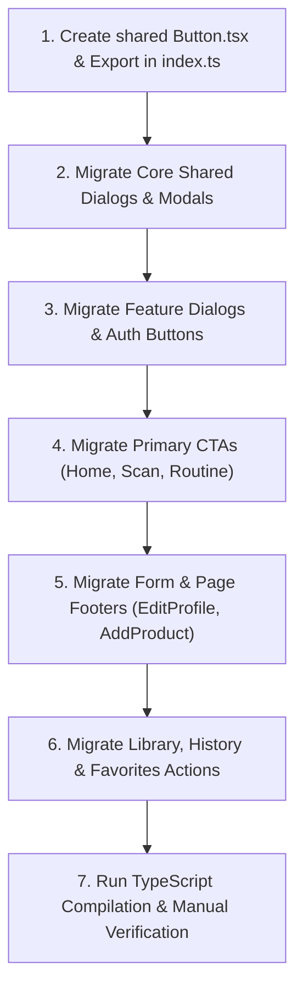

# AureSkin — Global Button Component Migration Implementation Plan

## 1. Overview & Objectives

| Property | Value |
|---|---|
| **Feature / Task** | Global Shared `Button` Component Creation & App-Wide Migration |
| **New Component** | `frontend/src/shared/components/Button.tsx` |
| **Barrel Export** | `frontend/src/shared/components/index.ts` |
| **Design Rules** | Strict adherence to `aureskin-frontend-rules`, `frontend/tailwind.config.js`, and `frontend/src/shared/theme/index.ts` |
| **Target Areas** | Dialogs/Modals, Auth, Home, Scan, Routine, Library, Profile, History, Favorites, Help, and About |
| **Primary Goal** | Eliminate all hardcoded `<Pressable>` and `<TouchableOpacity>` button elements across the application, standardizing them into a single, cohesive, type-safe, and token-compliant `<Button>` component. |

---

## 2. Design System & Design Token Audit

In accordance with `aureskin-frontend-rules`:

### 2.1 Border Radius Presets
- **Standard Buttons (`rounded-button`):** `12px` (`rounded-button` in `tailwind.config.js`). Default for all standard buttons, CTAs, and modal actions.
- **Pill Buttons (`rounded-full`):** `9999px` (`rounded-full`). Used for camera controls, submit photo pills, and floating action buttons.
- **Card Action Buttons (`rounded-card`):** `16px` (`rounded-card`). Used for large selectable action tiles (e.g., Scan overlay choices).
- **Input/Control Buttons (`rounded-input`):** `10px` (`rounded-input`). Used for small inline controls or compact steppers.

### 2.2 Typography & Font Presets
- **`text-label` (14px / 20px, `font-sans-bold` or `font-sans-semibold`):** High-prominence CTAs (e.g., "SCAN SKIN NOW!", "GENERATE SKINCARE ROUTINE", "Save Changes").
- **`text-body-sm` (14px / 20px, `font-sans-semibold`):** Standard dialog buttons ("Cancel", "Delete", "Confirm"), swap candidates, and form buttons.
- **`text-body` (16px / 24px, `font-sans-semibold`):** Large hero and auth buttons.
- **`text-caption` (12px / 16px, `font-sans-medium` or `font-sans-semibold`):** Small inline retry buttons, filter tags, and compact secondary actions.

### 2.3 Color Token Mapping
| Variant | Container Class | Text Class | Border / Shadow | Use Case |
|---|---|---|---|---|
| `primary` | `bg-primary active:opacity-90` | `text-neutral-white font-sans-semibold` | None / optional `shadow-sm` | Primary brand actions, confirm dialogs, submit profile |
| `secondary` | `bg-secondary active:opacity-90` | `text-neutral-white font-sans-bold` | `shadow-sm` | High-conversion CTAs (Scan Now, Generate Routine, Auth CTA) |
| `outline` | `bg-card active:bg-neutral-offwhite` | `text-text font-sans-semibold` | `border border-border` | Cancel buttons, secondary dismiss, go back |
| `outline-primary` | `bg-card active:bg-primary/10` | `text-primary font-sans-semibold` | `border border-primary` | Inverted primary outline (retry, secondary positive actions) |
| `outline-secondary`| `bg-card active:bg-secondary/10` | `text-secondary font-sans-semibold` | `border border-secondary` | Secondary brand outline (discard form, alternate flow) |
| `outline-danger` | `bg-card active:bg-status-error/10` | `text-error font-sans-semibold` | `border border-error` | Outlined destructive action (e.g. Delete Product button) |
| `danger` | `bg-status-error active:opacity-85` | `text-neutral-white font-sans-semibold` | None | Permanent delete confirmation, discard confirmation |
| `white` | `bg-neutral-white active:opacity-90` | `text-neutral-text font-sans-bold` | `shadow-md` | Floating camera controls, Scan modal options |
| `ghost` | `bg-transparent active:bg-neutral-border/30` | `text-primary font-sans-semibold` | None | Inline text-only buttons (Retry, Skip, Clear) |

---

## 3. Global Shared Component Specification (`Button.tsx`)

### 3.1 Interface Definition
```typescript
import React from 'react';
import {
  Pressable,
  PressableProps,
  StyleProp,
  ViewStyle,
  TextStyle,
} from 'react-native';

export type ButtonVariant =
  | 'primary'
  | 'secondary'
  | 'outline'
  | 'outline-primary'
  | 'outline-secondary'
  | 'outline-danger'
  | 'danger'
  | 'white'
  | 'ghost';

export type ButtonSize = 'sm' | 'md' | 'lg';
export type ButtonShape = 'rounded' | 'pill' | 'card' | 'input';

export interface ButtonProps extends Omit<PressableProps, 'children'> {
  /** Text title label. Can also provide custom children. */
  title?: string;
  children?: React.ReactNode;

  /** Visual color and surface style preset */
  variant?: ButtonVariant;

  /** Size preset controlling padding, height, and typography */
  size?: ButtonSize;

  /** Corner radius preset */
  shape?: ButtonShape;

  /** Stretches button width to 100% of parent */
  fullWidth?: boolean;

  /** Shows an ActivityIndicator while keeping button dimensions intact */
  isLoading?: boolean;

  /** Disabled state */
  disabled?: boolean;

  /** Left-aligned icon or render prop accepting current icon color & size */
  leftIcon?: React.ReactNode | ((props: { color: string; size: number }) => React.ReactNode);

  /** Right-aligned icon or render prop accepting current icon color & size */
  rightIcon?: React.ReactNode | ((props: { color: string; size: number }) => React.ReactNode);

  /** Additional container styling classes via Tailwind / NativeWind */
  className?: string;

  /** Additional label text styling classes via Tailwind / NativeWind */
  textClassName?: string;

  /** Custom text color override (if necessary) */
  textColor?: string;

  /** Force uppercase styling with character tracking */
  uppercase?: boolean;

  /** Optional container style override */
  style?: StyleProp<ViewStyle>;

  /** Optional text style override */
  textStyle?: StyleProp<TextStyle>;
}
```

### 3.2 Component Architecture & Features
1. **Dynamic Token & Size Resolution:**
   - Maps `variant`, `size`, and `shape` cleanly to authorized NativeWind classes.
   - Automatically resolves matching `theme.colors.*` for `ActivityIndicator` and dynamic icon render functions.
2. **Accessible by Default:**
   - Always sets `accessibilityRole="button"`.
   - Populates `accessibilityState={{ disabled: !!disabled, busy: !!isLoading }}`.
   - Falls back `accessibilityLabel` to `title` when not explicitly supplied.
3. **Seamless Flexible Content:**
   - Supports simple `title="Confirm"` for 90% of buttons.
   - Supports `leftIcon` and `rightIcon` with automated spacing (`mr-2`, `ml-2`).
   - Supports rich `children` for custom multi-column or complex inner layouts (e.g. `ScanActionButton` or `SubmitControls`).
4. **Touch & Press Feedback:**
   - Integrates subtle tactile scaling / opacity via NativeWind active classes (`active:opacity-85`, `active:scale-[0.98]`).

---

## 4. Migration Scope: Screen-by-Screen Inventory

### Phase 1: Shared Modals & Dialogs
Replace hardcoded dialog action buttons with standardized `<Button>`:

| File | Current Implementation | Migration to `<Button>` |
|---|---|---|
| `src/shared/components/DeleteDialog.tsx` | Cancel `<Pressable>` & Confirm `<Pressable>` | Cancel: `<Button variant="outline" size="md" fullWidth>`<br>Confirm: `<Button variant="danger" size="md" fullWidth>` |
| `src/shared/components/NotifDialog.tsx` | Cancel `<Pressable>` & Confirm `<Pressable>` | Cancel: `<Button variant="outline" size="md" fullWidth>`<br>Confirm: `<Button variant="primary" size="md" fullWidth>` |
| `src/shared/components/CalendarPickerModal.tsx` | Quick selectors, Cancel, Done buttons | Cancel: `<Button variant="outline" size="md">`<br>Done: `<Button variant="primary" size="md">` |
| `src/shared/components/ProductDetailPage.tsx` | Go Back, Retry, Delete Product buttons | Go Back: `<Button variant="outline" size="md">`<br>Retry: `<Button variant="primary" size="md">`<br>Delete: `<Button variant="outline-danger" size="md" fullWidth>` |
| `src/shared/components/IngredientDetailPage.tsx`| Go Back, Retry error buttons | Go Back: `<Button variant="outline" size="md">`<br>Retry: `<Button variant="primary" size="md">` |

---

### Phase 2: Feature-Specific Modals & Dialogs
| File | Current Implementation | Migration to `<Button>` |
|---|---|---|
| `src/features/profile/view/components/DiscardDialog.tsx` | Keep Editing & Discard | Keep: `<Button variant="outline" size="md" fullWidth>`<br>Discard: `<Button variant="danger" size="md" fullWidth>` |
| `src/features/routine/view/components/DeleteRoutineDialog.tsx` | Keep Routine & Delete | Keep: `<Button variant="outline" size="md" fullWidth>`<br>Delete: `<Button variant="danger" size="md" fullWidth>` |
| `src/features/routine/view/components/DiscardRoutineDialog.tsx` | Keep Editing & Discard | Keep: `<Button variant="outline" size="md" fullWidth>`<br>Discard: `<Button variant="danger" size="md" fullWidth>` |
| `src/features/routine/view/components/NewSkinAnalysisDetectedDialog.tsx` | Dismiss & Update Routine | Dismiss: `<Button variant="outline" size="md" fullWidth>`<br>Update: `<Button variant="primary" size="md" fullWidth>` |
| `src/features/scan/view/components/AnalysisErrorModal.tsx` | Dismiss & Retry | Dismiss: `<Button variant="outline" size="md" fullWidth>`<br>Retry: `<Button variant="primary" size="md" fullWidth>` |
| `src/features/scan/view/components/SkinGuidanceModal.tsx` | "Got It, Let's Scan" CTA | `<Button variant="primary" size="lg" fullWidth>` |

---

### Phase 3: Auth & Onboarding
| File | Current Implementation | Migration to `<Button>` |
|---|---|---|
| `src/features/auth/view/components/AuthButton.tsx` | Custom `<Pressable>` with spinner | Refactor to wrap `<Button variant="secondary" size="lg" fullWidth isLoading={isLoading} disabled={disabled} title={title} />` |
| `src/features/auth/view/components/OAuthButton.tsx` | Custom `<Pressable>` with icon | Refactor to wrap `<Button variant="outline" size="lg" fullWidth leftIcon={icon} title={title} />` |
| `src/features/auth/view/LoginPage.tsx` & `RegisterPage.tsx` | Action buttons | Leverage refactored `AuthButton` / `Button` |

---

### Phase 4: Home & Scan Features
| File | Current Implementation | Migration to `<Button>` |
|---|---|---|
| `src/features/home/view/components/HeroCard.tsx` | "SCAN SKIN NOW!" `<TouchableOpacity>` | `<Button variant="secondary" size="md" uppercase title="SCAN SKIN NOW!" onPress={onScanPress} />` |
| `src/features/home/view/components/AnalysisSummaryCard.tsx` | "View Details" & "Retake Scan" | `<Button variant="outline" size="sm">` & `<Button variant="primary" size="sm">` |
| `src/features/scan/view/components/ScanActionButton.tsx` | Take Photo & Upload Photo cards | Refactor to `<Button variant="white" shape="card" size="lg" fullWidth leftIcon={Icon} title={label} />` |
| `src/features/scan/view/components/SubmitControls.tsx` | Retake & Submit Photo pills | Retake: `<Button variant="white" shape="pill" size="md" leftIcon={<RotateCcw />}>`<br>Submit: `<Button variant="white" shape="pill" size="md" rightIcon={<ArrowRight />} title="Analyze Skin">` |
| `src/features/scan/view/components/ResultsCompatabilityToggle.tsx` | Segmented toggle buttons | `<Button variant={active ? 'primary' : 'ghost'} size="sm">` |

---

### Phase 5: Skincare Routine Feature
| File | Current Implementation | Migration to `<Button>` |
|---|---|---|
| `src/features/routine/view/components/RoutineGenerationCard.tsx` | "GENERATE SKINCARE ROUTINE" `<Pressable>` | `<Button variant="secondary" size="lg" fullWidth uppercase isLoading={isGenerating} disabled={!canGenerate} rightIcon={<ArrowRight />} title="GENERATE SKINCARE ROUTINE" />` |
| `src/features/routine/view/components/RoutineSkinProfileCard.tsx` | "View Analysis" & "Generate Routine" | `<Button variant="outline" size="sm">` & `<Button variant="primary" size="sm">` |
| `src/features/routine/view/components/PopUpOptionPanel.tsx` | Option action items | `<Button variant="outline" size="md" fullWidth>` |
| `src/features/routine/view/components/PopUpSwapProductPanel.tsx` | Swap modal action buttons | `<Button variant="primary" size="md" fullWidth>` |

---

### Phase 6: Library & Product Management
| File | Current Implementation | Migration to `<Button>` |
|---|---|---|
| `src/features/library/view/AddProductPage.tsx` | Cancel & Submit `<Pressable>` | Cancel: `<Button variant="outline-secondary" size="lg" fullWidth title="Cancel">`<br>Submit: `<Button variant="secondary" size="lg" fullWidth isLoading={form.isSubmitting} title="Add Product">` |
| `src/features/library/view/components/ProductAddedConfirmation.tsx` | View in Library & Add Another | View: `<Button variant="primary" size="md" fullWidth>`<br>Add: `<Button variant="outline" size="md" fullWidth>` |
| `src/features/library/view/components/PopUpProductCategoryPanel.tsx` | Reset & Apply Filter | Reset: `<Button variant="outline" size="md" fullWidth>`<br>Apply: `<Button variant="primary" size="md" fullWidth>` |

---

### Phase 7: Profile, History & Favorites
| File | Current Implementation | Migration to `<Button>` |
|---|---|---|
| `src/features/profile/view/EditProfilePage.tsx` | Footer Cancel & Save Changes | Cancel: `<Button variant="outline" size="lg" fullWidth title="Cancel">`<br>Save: `<Button variant="primary" size="lg" fullWidth title="Save Changes">` |
| `src/features/profile/view/ProfilePage.tsx` | Edit Profile, Sign Out, Delete Account | Edit: `<Button variant="primary" size="md" fullWidth>`<br>Sign Out: `<Button variant="outline" size="md" fullWidth>`<br>Delete: `<Button variant="outline-danger" size="md" fullWidth>` |
| `src/features/history/view/components/HistoryDetailHeader.tsx` | Action buttons | `<Button variant="ghost" size="sm">` / `<Button variant="outline" size="sm">` |
| `src/features/history/view/components/PopUpHistoryFilterPanel.tsx` | Reset & Apply Filter | Reset: `<Button variant="outline" size="md" fullWidth>`<br>Apply: `<Button variant="primary" size="md" fullWidth>` |
| `src/features/favorites/view/FavoritesPage.tsx` | Explore Library CTA | `<Button variant="primary" size="md" title="Explore Products">` |

---

## 5. Implementation Steps & Milestones



### Milestone 1: Create Shared Component
1. Create `frontend/src/shared/components/Button.tsx`.
2. Add comprehensive prop types, style mappings, and token lookups.
3. Export from `frontend/src/shared/components/index.ts`.

### Milestone 2: Migrate Shared Layer Dialogs & Screens
1. Migrate `DeleteDialog.tsx` and `NotifDialog.tsx`.
2. Migrate `ProductDetailPage.tsx` and `IngredientDetailPage.tsx`.
3. Migrate `CalendarPickerModal.tsx`.

### Milestone 3: Migrate Feature-Level Modals & Dialogs
1. Migrate `DiscardDialog.tsx` (Profile).
2. Migrate `DeleteRoutineDialog.tsx`, `DiscardRoutineDialog.tsx`, and `NewSkinAnalysisDetectedDialog.tsx` (Routine).
3. Migrate `AnalysisErrorModal.tsx` and `SkinGuidanceModal.tsx` (Scan).

### Milestone 4: Migrate Primary Screen CTAs & Action Banners
1. Migrate `HeroCard.tsx` (Home).
2. Migrate `RoutineGenerationCard.tsx` (Routine).
3. Migrate `ScanActionButton.tsx` and `SubmitControls.tsx` (Scan).
4. Migrate `AuthButton.tsx` and `OAuthButton.tsx` (Auth).

### Milestone 5: Migrate Forms & Page Footers
1. Migrate `EditProfilePage.tsx` (Cancel & Save Changes footer).
2. Migrate `AddProductPage.tsx` (Cancel & Submit form actions).
3. Migrate `ProfilePage.tsx` (Action list buttons).

### Milestone 6: Migrate Category, Filter & Secondary Actions
1. Migrate `PopUpProductCategoryPanel.tsx` and `ProductAddedConfirmation.tsx` (Library).
2. Migrate `PopUpOptionPanel.tsx` and `PopUpSwapProductPanel.tsx` (Routine).
3. Migrate `PopUpHistoryFilterPanel.tsx` and empty states (History & Favorites).

### Milestone 7: Verification & Quality Assurance
1. Run `npx tsc --noEmit` across `frontend/` to ensure zero compilation or typing regressions.
2. Verify all button styles, active feedback states, and accessibility compliance.
3. Test in Expo Go across key screens.

---

## 6. Verification Checklist

- [ ] `frontend/src/shared/components/Button.tsx` implemented strictly using AureSkin tokens (`rounded-button`, `text-label`, `bg-primary`, `bg-secondary`, `bg-status-error`, etc.).
- [ ] Exported in `frontend/src/shared/components/index.ts`.
- [ ] Zero arbitrary colors (e.g. no hardcoded `#6B7B4C` or `#FFFFFF`).
- [ ] Zero generic Tailwind sizes (no `text-xs`, `text-sm`, `text-lg`; strictly `text-caption`, `text-body-sm`, `text-label`, `text-body`).
- [ ] Loading state gracefully retains button height and width while showing `ActivityIndicator`.
- [ ] Disabled state prevents clicks and applies `opacity-50` / `opacity-60`.
- [ ] All 10+ core target screens and dialogs migrated to use `<Button>`.
- [ ] `npx tsc --noEmit` exits with code 0.

