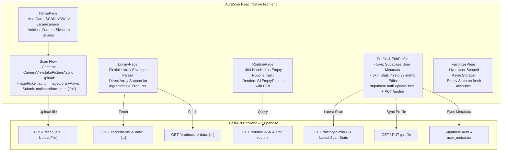

# Implementation Plan: Live Mode Fixes & Real Data Integration

**Target Areas:**
1. Home Page (Curated Articles Fallback & SCAN SKIN NOW! CTA)
2. Scan Workflow (Real Camera Capture, Native Device Gallery Picker & API Payload Fix)
3. Library Page (FastAPI Array Envelope Parsing for Ingredients & Products)
4. Routine Page (404 Empty State Handling & s1_EmptyRoutine Integration)
5. Profile & Edit Profile Page (Separation of Live vs Mock Data, Fresh User States, Real Metadata Persistence)
6. Favorites Page (User-Scoped AsyncStorage Persistence for Live Mode)

**Document Reference:** `documentation/part2_technical_view.md`  
**Design Reference:** `frontend/design_references/ui_design_reference.md`  
**Theme Tokens:** `frontend/src/shared/theme/index.ts`  
**Tailwind Configuration:** `frontend/tailwind.config.js`  
**Mock Config:** `frontend/src/shared/config/mockConfig.ts`

---

## 1. Executive Summary & Root Cause Analysis

During end-to-end testing against the running FastAPI backend (`http://192.168.18.61:8000`) and live Supabase instance with authentication active, several issues were identified where features failed to load real data or fell back to mock fixtures:

| Feature Area | Observed Issue | Root Cause | Planned Fix |
|---|---|---|---|
| **Home: Articles** | Articles fail to load in live mode. | `fetchArticles()` queries Supabase `articles` table which is unpopulated, returning `[]` on empty/error. | Fallback to `MOCK_ARTICLES` (curated skincare guides) so educational articles always render reliably in both live and mock modes. |
| **Home: Scan CTA** | "SCAN SKIN NOW!" button does nothing when tapped. | `HeroCard.tsx` navigates to `/(tabs)/scan`, which renders `<Redirect href="/(tabs)" />`. | Change navigation in `HomePage.tsx` / `HeroCard.tsx` to `router.push('/scan/camera')` to open the camera capture screen directly. |
| **Scan: Camera** | Permission granted but capture does not take real photo; falls back to mock photo. | 1. `useScanCamera.ts` imports static `USE_MOCK` boolean from `scan_api.ts`.<br>2. `cameraRef` readiness (`onCameraReady`) not tracked.<br>3. Silent fallback catch blocks catch exceptions and push `MOCK_CAMERA_PHOTO_URI`. | 1. Use dynamic `isMockEnabled('scan')`.<br>2. Track `isCameraReady` state before calling `takePictureAsync`.<br>3. Ensure captured `photo.uri` flows to `/scan/submit`. Provide clear error toast if camera hardware fails. |
| **Scan: Gallery** | "Upload a photo" button and camera bottom-left thumbnail show template stock photos instead of device gallery. | Both triggers route to `/scan/upload`, which loads `MOCK_GALLERY_PHOTOS`. | Change both triggers to directly invoke `ImagePicker.launchImageLibraryAsync({ mediaTypes: ['images'], allowsEditing: true, quality: 0.85 })` and navigate straight to `/scan/submit`. |
| **Scan: Submit API** | Analysis submission fails in live mode. | FastAPI `POST /scan` endpoint (`scan_router.py:22`) requires form field name `file: UploadFile = File(...)`. Frontend `scan_api.ts:61` was sending `formData.append('image', ...)`, resulting in a `422 Unprocessable Entity`. | Update `scan_api.ts` to append `'file'` to `FormData` matching FastAPI's parameter specification. |
| **Library: Ingredients & Products** | Ingredients and Products tabs fail to display items in live mode (`"The ingredient service returned an unexpected response"`). | FastAPI returns `{ data: [...] }` (direct JSON array). `library_api.ts` asserted `isRecord(response.data.data)` and `response.data.data.items`. Because `isRecord` rejects arrays (`!Array.isArray`), the check threw an exception. | Update `fetchIngredients` and `fetchProducts` to accept both direct array payloads (`Array.isArray(response.data.data) ? response.data.data : response.data.data?.items`) and normalize correctly. |
| **Routine: Empty State** | New user without routine sees raw error banner `"no active routine found of this user"` instead of the designed empty-state screen. | When user has no routine, FastAPI returns `404 Not Found`. `fetchRoutine` threw an AxiosError which `RoutinePage.tsx` rendered as a blocking error view rather than rendering `S1EmptyRoutine`. | In `routine_api.ts`, catch 404 status and return `null`. In `RoutinePage.tsx`, when `routine === null` without unexpected errors, render `S1EmptyRoutine` with "Generate Routine" CTA. |
| **Favorites** | Still shows hardcoded mock data in live mode. | `favorites_api.ts:21` literally returned `[...MOCK_FAVORITE_ITEMS]` even when `USE_MOCK` is false. | In live mode, persist user favorites to `AsyncStorage` scoped to user ID (`@aureskin_favorites_${userId}`). Initial state for a fresh user is empty (`[]`), rendering the empty state UI. |
| **Profile & Edit Profile** | Fresh user profile displays "Cathy Reyes", `@cathyreyes_20`, mock Unsplash avatar, and hardcoded `Oily / 89 / Skin Condition`. | 1. Feature key `'profile'` missing from `mockConfig.ts`.<br>2. `useProfile.ts` and `useEditProfile.ts` fall back to `MOCK_USER_PROFILE` constants for all fields.<br>3. Skin stats are hardcoded constants rather than querying user's latest scan. | 1. Add `'profile'` to `mockConfig.ts`.<br>2. In live mode, derive profile fields from Supabase `user.user_metadata` or leave blank for fresh users.<br>3. In live mode, fetch skin stats from latest scan (`/history?limit=1`); if no scan, render empty/unscanned overview.<br>4. Persist edits to Supabase `auth.updateUser` and `PUT /profile`. |

---

## 2. Technical Architecture & Data Flows



---

## 3. Step-by-Step Implementation Details

### Step 1: Mock Configuration & Feature Key Registry
**File:** `frontend/src/shared/config/mockConfig.ts`
- Add `'profile'` to `FeatureKey` union type and default `FEATURE_OVERRIDES` registry:
  ```typescript
  export type FeatureKey =
    | 'home'
    | 'library'
    | 'scan'
    | 'history'
    | 'routine'
    | 'favorites'
    | 'about'
    | 'help'
    | 'profile';
  ```
- Ensure `MASTER_OVERRIDE: boolean | null = false` cleanly disables mocks across all features when in live mode.

---

### Step 2: Home Page (Articles & Scan CTA)
**Files:**
- `frontend/src/features/home/model/home_api.ts`
- `frontend/src/features/home/view/HomePage.tsx`

**Modifications:**
1. **Curated Articles:**
   In `home_api.ts` `fetchArticles()`:
   If `supabase.from('articles')` returns an error or empty array (`data.length === 0`), fall back to `MOCK_ARTICLES` (renamed conceptually to `CURATED_ARTICLES`). This guarantees that educational skincare content is always available to live users.
2. **Scan CTA Routing:**
   In `HomePage.tsx` line 52:
   ```tsx
   // Replace:
   <HeroCard onScanPress={() => router.push('/(tabs)/scan')} />
   // With:
   <HeroCard onScanPress={() => router.push('/scan/camera')} />
   ```
   Tapping "SCAN SKIN NOW!" directly opens the camera capture viewfinder.

---

### Step 3: Scan Workflow (Real Camera, Gallery & Submission)
**Files:**
- `frontend/src/features/scan/model/scan_api.ts`
- `frontend/src/features/scan/viewmodel/useScanCamera.ts`
- `frontend/src/features/scan/viewmodel/useScan.ts`
- `frontend/src/features/scan/viewmodel/useScanSubmit.ts`
- `frontend/src/features/scan/view/containers/camera/s1_CameraViewfinder.tsx`
- `frontend/src/features/scan/view/containers/camera/s2_CameraControls.tsx`
- `frontend/src/features/scan/view/containers/overlay/s1_ScanOptions.tsx`

**Modifications:**
1. **Backend Form-Data Field Fix:**
   In `scan_api.ts` `uploadScan()`:
   FastAPI endpoint expects `file: UploadFile = File(...)`. Change:
   ```typescript
   // Replace:
   formData.append('image', { uri: imageUri, name: filename, type } as unknown as Blob);
   // With:
   formData.append('file', {
     uri: imageUri,
     name: filename,
     type,
   } as unknown as Blob);
   ```
2. **Direct System Gallery Picker:**
   - In `useScan.ts` (`handleUploadPhoto`): Instead of routing to the mock photo grid at `/scan/upload`, invoke `ImagePicker.launchImageLibraryAsync({ mediaTypes: ['images'], allowsEditing: true, quality: 0.85 })`. If a photo is selected, navigate directly to `/scan/submit` with `params: { imageUri: result.assets[0].uri }`.
   - In `useScanCamera.ts` (`navigateToUpload` / gallery thumbnail press): Use `ImagePicker.launchImageLibraryAsync` to let user pick from their real gallery, navigating directly to `/scan/submit`.
3. **Real Camera Capture:**
   In `useScanCamera.ts`:
   - Replace static import `USE_MOCK` with dynamic `isMockEnabled('scan')`.
   - Track `isCameraReady` state via `onCameraReady` prop on `CameraView`.
   - In `capturePhoto()`:
     ```typescript
     if (!isMockEnabled('scan') && Platform.OS !== 'web' && cameraRef.current) {
       const photo = await cameraRef.current.takePictureAsync({
         quality: 0.85,
       });
       if (photo?.uri) {
         photoUri = photo.uri;
       }
     }
     ```
   - Only use mock photo URI if `isMockEnabled('scan')` is explicitly `true`. If real camera hardware capture fails, show a user-friendly error toast instead of silently replacing the photo with an unknown stock photo.
4. **Submit Preview Guard:**
   In `useScanSubmit.ts`:
   Ensure `imageUri` defaults to empty/placeholder only when testing without params, and passes the actual user photo to `/scan/analyzing`.

---

### Step 4: Library Page (FastAPI Array Envelope Parsing)
**File:** `frontend/src/features/library/model/library_api.ts`

**Modifications:**
1. **Ingredients Parsing (`fetchIngredients`):**
   Update the response parsing logic to support both `response.data.data` as an array (standard FastAPI response) and wrapped `{ items: [...] }`:
   ```typescript
   const rawPayload = (response.data as any)?.data;
   let rawItems: unknown[] = [];

   if (Array.isArray(rawPayload)) {
     rawItems = rawPayload;
   } else if (rawPayload && typeof rawPayload === 'object' && Array.isArray(rawPayload.items)) {
     rawItems = rawPayload.items;
   } else {
     throw new Error('The ingredient service returned an unexpected response format.');
   }
   ```
2. **Products Parsing (`fetchProducts`):**
   Apply the same flexible array parsing:
   ```typescript
   const rawPayload = (response.data as any)?.data;
   let rawItems: unknown[] = [];

   if (Array.isArray(rawPayload)) {
     rawItems = rawPayload;
   } else if (rawPayload && typeof rawPayload === 'object' && Array.isArray(rawPayload.items)) {
     rawItems = rawPayload.items;
   } else {
     throw new Error('The product service returned an unexpected response format.');
   }
   ```

---

### Step 5: Routine Page (404 Empty State Handling)
**Files:**
- `frontend/src/features/routine/model/routine_api.ts`
- `frontend/src/features/routine/viewmodel/useRoutine.ts`
- `frontend/src/features/routine/view/RoutinePage.tsx`

**Modifications:**
1. **Handle 404 in `fetchRoutine`:**
   In `routine_api.ts`:
   ```typescript
   export async function fetchRoutine(): Promise<SkincareRoutine | null> {
     if (isMockEnabled('routine')) return mockCurrentRoutine;

     try {
       const response = await api.get('/routine');
       const payload = response.data?.data;
       if (payload === null || payload?.routine === null) return null;
       if (!payload || typeof payload !== 'object') {
         return null;
       }
       return normalizeRoutine(payload.routine ?? payload);
     } catch (error: any) {
       // A 404 from FastAPI indicates the user has not generated a routine yet
       if (error?.response?.status === 404) {
         return null;
       }
       throw error;
     }
   }
   ```
2. **Clean Empty State in `RoutinePage.tsx`:**
   In `RoutinePage.tsx`:
   When `routineQuery.data === null` and no real network error occurred, render `S1EmptyRoutine` with "Generate Routine" CTA. Only display the error retry banner if a non-404 unexpected network error occurred.

---

### Step 6: Favorites Page (Live Persistence with AsyncStorage)
**Files:**
- `frontend/src/features/favorites/model/favorites_api.ts`
- `frontend/src/features/favorites/viewmodel/useFavorites.ts`

**Modifications:**
1. In `favorites_api.ts`:
   - When `isMockEnabled('favorites')` is `true`: Return `MOCK_FAVORITE_ITEMS`.
   - When `isMockEnabled('favorites')` is `false`:
     Read favorites from `AsyncStorage.getItem('@aureskin_favorites_' + userId)`.
     If empty, return `[]`.
2. Provide `addFavoriteItem` and `removeFavoriteItem` functions that read/write the user-scoped JSON array in `AsyncStorage`.
3. In `useFavorites.ts`:
   When `favorites.length === 0`, `FavoritesPage` displays the designed empty state ("No favorites saved yet").

---

### Step 7: Profile & Edit Profile Page (Live vs Mock Separation)
**Files:**
- `frontend/src/features/profile/model/profile_api.ts` (create)
- `frontend/src/features/profile/viewmodel/useProfile.ts`
- `frontend/src/features/profile/viewmodel/useEditProfile.ts`
- `frontend/src/features/profile/view/components/SkinOverviewCard.tsx`
- `frontend/src/features/profile/view/ProfilePage.tsx`

**Modifications:**
1. **Create `profile_api.ts`:**
   - `fetchUserProfile(userId: string)`:
     - If `isMockEnabled('profile')`: Return `MOCK_USER_PROFILE`.
     - If live: Fetch user profile from `/profile` and Supabase user metadata.
   - `fetchUserSkinOverview(userId: string)`:
     - If `isMockEnabled('profile')`: Return `{ skinType: 'Oily', healthScore: 89, conditions: ['Skin Condition'] }`.
     - If live: Fetch `/history?limit=1`. If no history items exist, return `{ skinType: null, healthScore: null, conditions: [] }`.
   - `updateUserProfile(draft: EditProfileDraft)`:
     - Update Supabase user metadata via `supabase.auth.updateUser({ data: ... })`.
     - Call FastAPI `PUT /profile` with `{ display_name, avatar_url }`.
2. **Update `useProfile.ts`:**
   - In live mode (`!isMockEnabled('profile')`):
     - Profile info (`firstName`, `lastName`, `username`, `phoneNumber`, `dateOfBirth`, `gender`, `avatarUri`, `allergens`) defaults to actual user values or empty strings/null for newly registered users.
     - Skin Overview defaults to `null` if no past skin scans exist.
3. **Update `SkinOverviewCard.tsx`:**
   - If `skinType` is `null` or uncalculated, render a clean empty state card:
     - Health gauge displays `--` or 0.
     - Label displays "No Scan Recorded Yet".
     - Subtext prompts: "Perform your first skin analysis to see your skin type and health score."
4. **Update `useEditProfile.ts`:**
   - Form fields initialize empty for a fresh account in live mode (no "Cathy Reyes" pre-population).
   - "Save" calls `updateUserProfile` and persists to Supabase and backend.

---

## 4. Design System & Token Compliance (`aureskin-frontend-rules`)

All UI components touched in this plan adhere strictly to AureSkin tokens:
- **Colors:** `bg-primary`, `bg-card`, `bg-secondary`, `bg-background`, `text-text`, `text-muted`, `border-border`.
- **Theme tokens in props:** `theme.colors.card`, `theme.colors.primary`, `theme.colors.muted`.
- **Font Sizes:** `text-display`, `text-h1`, `text-h2`, `text-h3`, `text-body`, `text-body-sm`, `text-caption`, `text-label`. No arbitrary or Tailwind generic sizes (`text-xs`, `text-sm`, `text-lg`).
- **Border Radii:** `rounded-card` (16px), `rounded-button` (12px), `rounded-input` (10px), `rounded-full` (9999px).
- **Font Families:** `font-sans`, `font-sans-medium`, `font-sans-semibold`, `font-sans-bold`, `font-heading`.

---

## 5. Verification & Testing Checklist

- [ ] **Home Articles:** Load Home screen with `MASTER_OVERRIDE: false`. Verify curated educational articles render properly.
- [ ] **Home Scan CTA:** Tap "SCAN SKIN NOW!". Verify it navigates directly to the camera screen (`/scan/camera`).
- [ ] **Camera Capture:**
  - Verify live camera viewfinder initializes with permissions granted.
  - Press shutter button. Verify a real captured photo URI is passed to `/scan/submit`.
- [ ] **Device Gallery Picker:**
  - Tap "Upload a photo" in `ScanOverlay` -> Native photo picker opens.
  - Tap bottom-left thumbnail in camera viewfinder -> Native photo picker opens.
  - Selecting a photo routes to `/scan/submit` with the chosen photo preview.
- [ ] **Scan Submission:**
  - Tap "Analyze Photo" on `/scan/submit`.
  - Verify network request `POST /scan` sends `file` in form-data.
  - Verify analysis completes or handles ML inference gracefully.
- [ ] **Library Data:**
  - Navigate to Library -> Ingredients tab. Verify Supabase ingredients load and paginate without response format errors.
  - Switch to Products tab. Verify Supabase products load and paginate without errors.
- [ ] **Routine Empty State:**
  - Navigate to Routine tab with a fresh account that has no routine.
  - Verify the "No routine yet" (`s1_EmptyRoutine`) empty state displays with "Generate Routine" button (no 404 error banner).
- [ ] **Favorites:**
  - Navigate to Favorites tab on a fresh account. Verify empty state displays.
- [ ] **Profile & Edit Profile:**
  - Navigate to Profile with fresh account. Verify fields are empty / blank (no "Cathy Reyes").
  - Verify Skin Overview displays unanalyzed state when user has no scan history.
  - Navigate to Edit Profile. Verify fields are blank, fill them in, save, and verify persistence.

