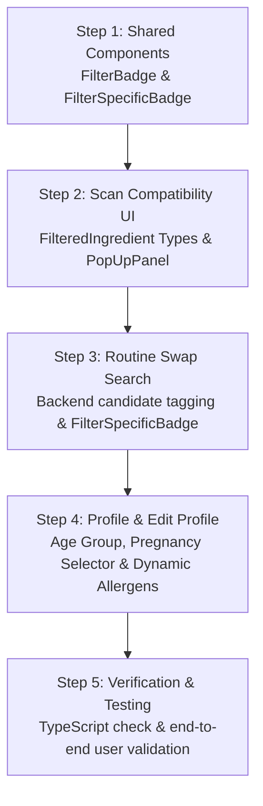

# Implementation Plan: Clinical Profile Filters Frontend Integration

**Target Feature:** Clinical Profile Filters (Allergens, Pregnancy, Age Groups) UI & Workflow Integration  
**Date:** November 16, 2026  
**Status:** Pending Review  
**Skill Reference:** `aureskin-frontend-rules`, `aureskin-screen-architecture-implementation`  

---

## 1. Executive Summary

Now that the backend and Supabase clinical filter architecture is fully operational (with 5 populated reference and join tables, profile endpoints, and 3-way clinical filtering in both compatibility analysis and routine recommendations), this plan specifies the frontend modifications required to surface these clinical protections to the user.

### Core Objectives
1. **Scan Results (Compatible Ingredients Tab):**
   - Display a `FilterBadge` on the upper right of the "COMPATIBLE INGREDIENTS" card (`Card style={2}`) showing `Filtered (N)` using the `concern` color token (`#FA8B89`).
   - Tapping the badge opens a global `PopUpPanel` (`style={2}`) showing excluded ingredients grouped by applicable clinical categories: **Allergen Sensitivities**, **Pregnancy Cautions**, and **Age Group Suitability**.
2. **Routine Generation & Swap Modal:**
   - Default recommendations continue to strictly exclude all contraindicated products.
   - When users explicitly search in the swap modal (`PopUpSwapProductPanel`), searched products that match the query but are contraindicated will display a `FilterSpecificBadge` indicating the specific contraindication: `✕ Age`, `✕ Pregnant`, and `✕ Allergen` using the cross symbol and `concern` color token.
3. **Profile & Edit Profile:**
   - In `ProfileInfoCard`, display the user's computed age and life stage label (`Teen`, `Young Adult`, `Adult`, `Mature`), pregnancy status (`Pregnant` / `Not Pregnant`), and active allergens.
   - In `EditProfilePage`, dynamically load the 16 medical allergen categories from `GET /profile/allergies` into multi-select chips, and provide an intuitive, accessible pregnancy toggle (Yes / No).
4. **Design System & Architectural Compliance:**
   - Strict adherence to `aureskin-frontend-rules`:
     - Font size presets: `text-caption`, `text-body-sm`, `text-body`, `text-h3`, `text-h2`.
     - Font family presets: `font-sans`, `font-sans-medium`, `font-sans-semibold`, `font-sans-bold`.
     - Border radius presets: `rounded-badge`, `rounded-card`, `rounded-button`, `rounded-input`, `rounded-full`.
     - Color tokens: `bg-concern`, `text-concern`, `border-concern`, `bg-primary`, `text-text`, `text-muted`.
     - JS props: `theme.colors.concern`, `theme.colors.primary`, `theme.colors.card`.

---

## 2. Architecture & File Inventory

```
frontend/
├── src/
│   ├── shared/
│   │   ├── components/
│   │   │   ├── FilterBadge.tsx                 # [NEW] Pill badge "Filtered (N)" (concern token)
│   │   │   ├── FilterSpecificBadge.tsx         # [NEW] Pill badge "✕ Age", "✕ Pregnant", "✕ Allergen"
│   │   │   └── index.ts                        # [MODIFIED] Export new shared components
│   │   └── pages/scan_results/containers/
│   │       └── s3_CompatibilityTab.tsx         # [MODIFIED] Add FilterBadge & PopUpPanel (style={2})
│   ├── features/
│   │   ├── scan/
│   │   │   ├── model/
│   │   │   │   ├── scan_types.ts               # [MODIFIED] Add FilteredIngredient interface
│   │   │   │   ├── scan_api.ts                 # [MODIFIED] Normalize filtered_ingredients
│   │   │   │   └── scan_mock.ts                # [MODIFIED] Add mock filtered ingredients
│   │   ├── routine/
│   │   │   ├── model/
│   │   │   │   ├── routine_types.ts            # [MODIFIED] Add filter_reasons to RoutineProduct
│   │   │   │   └── routine_api.ts              # [MODIFIED] Map filter_reasons from /routine/swap-candidates
│   │   │   └── view/components/
│   │   │       └── PopUpSwapProductPanel.tsx   # [MODIFIED] Render FilterSpecificBadge on disqualified items
│   │   └── profile/
│   │       ├── model/
│   │       │   ├── profile_types.ts            # [MODIFIED] Add ageGroup, ageGroupLabel, isPregnant, CommonAllergy
│   │       │   └── profile_api.ts              # [MODIFIED] fetchCommonAllergies(), sync is_pregnant
│   │       ├── viewmodel/
│   │       │   ├── useProfile.ts               # [MODIFIED] Expose ageGroup, ageGroupLabel, isPregnant
│   │       │   └── useEditProfile.ts           # [MODIFIED] Support isPregnant draft & dynamic allergies
│   │       └── view/
│   │           ├── EditProfilePage.tsx         # [MODIFIED] Pregnancy Yes/No selector & 16 allergen chips
│   │           └── components/
│   │               └── ProfileInfoCard.tsx     # [MODIFIED] Display Age & Life Stage, Pregnancy, Allergens
backend/
├── features/
│   └── routine/
│       ├── routine_schemas.py                  # [MODIFIED] Add filter_reasons to SwapCandidateResponse
│       └── routine_service.py                  # [MODIFIED] Tag filter_reasons on search query in get_swap_candidates
```

---

## 3. Detailed Component & Feature Design

### 3.1 Shared Global Component: `FilterBadge`
- **Location:** `frontend/src/shared/components/FilterBadge.tsx`
- **Purpose:** Placed in card headers (e.g. Compatible Ingredients card) to indicate that clinical exclusions took place.
- **Props:**
  ```typescript
  export interface FilterBadgeProps {
    count: number;
    onPress?: () => void;
    className?: string;
  }
  ```
- **Styling:**
  - Container: `rounded-badge bg-concern/15 border border-concern/30 px-2.5 py-1 flex-row items-center gap-1 active:opacity-75`
  - Icon: Lucide `SlidersHorizontal` (size 12, `color={theme.colors.concern}`)
  - Text: `Filtered (${count})` with `text-caption font-sans-bold text-concern`
  - Accessibility: `accessibilityRole="button"`, `accessibilityLabel={`Filtered ${count} ingredients, tap to view reasons`}`

### 3.2 Shared Global Component: `FilterSpecificBadge`
- **Location:** `frontend/src/shared/components/FilterSpecificBadge.tsx`
- **Purpose:** Visual pill tag indicating why a searched product in the swap modal is contraindicated.
- **Props:**
  ```typescript
  export type FilterSpecificType = 'age' | 'pregnant' | 'pregnancy' | 'allergen' | 'allergies';

  export interface FilterSpecificBadgeProps {
    type: FilterSpecificType;
    className?: string;
  }
  ```
- **Visuals:**
  - `age` -> `✕ Age`
  - `pregnant` / `pregnancy` -> `✕ Pregnant`
  - `allergen` / `allergies` -> `✕ Allergen`
- **Styling:**
  - Container: `rounded-badge bg-concern/15 border border-concern/30 px-2 py-0.5 flex-row items-center gap-1`
  - Icon: Lucide `X` (size 11, `color={theme.colors.concern}`, strokeWidth 2.5)
  - Text: `text-caption font-sans-bold text-concern`
  - Accessibility: `accessibilityRole="text"`, `accessibilityLabel={`Filtered by ${type}`}`

---

### 3.3 Objective 1: Scan Results Compatibility Tab Integration

#### Data Types (`frontend/src/features/scan/model/scan_types.ts`)
```typescript
export interface FilteredIngredient {
  id: string;
  ingredient_id: string;
  name: string;
  filter_type: 'allergen' | 'pregnancy' | 'age' | string;
  reason: string;
  details?: string;
}

// Added to ScanResult & CompatibilityResponse:
filtered_ingredients?: FilteredIngredient[];
```

#### View Implementation (`frontend/src/shared/pages/scan_results/containers/s3_CompatibilityTab.tsx`)
1. **Header Row in Card (Style 2):**
   ```tsx
   <View className="flex-row items-center justify-between mb-2">
     <Text className="text-caption font-sans-bold text-accent uppercase tracking-wide">
       COMPATIBLE INGREDIENTS
     </Text>
     {filteredIngredients.length > 0 ? (
       <FilterBadge
         count={filteredIngredients.length}
         onPress={() => setIsFilteredPanelVisible(true)}
       />
     ) : null}
   </View>
   ```
2. **Interactive `PopUpPanel` (Style 2 - Content Only):**
   - Renders a sliding bottom sheet:
     - `title="Filtered Ingredients"`
     - `subtitle="Ingredients excluded based on your profile constraints"`
   - Groups items by `filter_type`:
     - **Allergen Sensitivities** (if any): Displays ingredient name, allergen tag, and clinical sensitivity reason.
     - **Pregnancy Cautions** (if any): Displays ingredient name and pregnancy contraindication note.
     - **Age Group Restrictions** (if any): Displays ingredient name and age group barrier guidance.
   - Each item is clickable to open `IngredientDetailPage`.
   - Only displays sections that have filtered items.

---

### 3.4 Objective 2: Routine Generation & Swap Search Integration

#### Backend Contract Update (`backend/features/routine/`)
- In `routine_schemas.py`: Add `filter_reasons: Optional[List[str]] = []` to `SwapCandidateResponse`.
- In `routine_service.py` -> `get_swap_candidates`:
  - When `search_query` is empty (default routine recommendation): Keep strictly returning only 100% clean, non-disqualified products.
  - When `search_query` is present:
    - Match products by search term.
    - Evaluate clinical rules against each candidate. If disqualified, compute specific reason tags (`'age'`, `'pregnant'`, `'allergen'`), set `is_recommended = False`, and assign `filter_reasons`.
    - Return both clean and flagged products, sorting recommended products first.

#### Frontend Routine Model & View (`frontend/src/features/routine/`)
- In `routine_types.ts`: Add `filter_reasons?: string[]` to `RoutineProduct`.
- In `routine_api.ts`: Pass `filter_reasons` through in `fetchProductOptions`.
- In `PopUpSwapProductPanel.tsx`:
  - When rendering each product in `renderProductItem`:
    - If `product.filter_reasons && product.filter_reasons.length > 0`:
      - Render `FilterSpecificBadge` pills horizontally:
        ```tsx
        <View className="flex-row items-center gap-1.5 mt-1 flex-wrap">
          {product.filter_reasons.map((reason) => (
            <FilterSpecificBadge key={reason} type={reason} />
          ))}
        </View>
        ```
    - If a user taps a contraindicated product:
      - Display a safety confirmation dialog via `Alert.alert`:
        *"Clinical Contraindication Warning: This product contains ingredients flagged for your profile ({reasons}). Do you still wish to select it?"*

---

### 3.5 Objective 3: Profile & Edit Profile Integration

#### Profile Info Display (`ProfileInfoCard.tsx`)
1. **Age & Life Stage Row:**
   - Icon: Lucide `CalendarDays` in `rounded-full bg-primary`
   - Label: `Age & Life Stage`
   - Value: `${profile.age} yrs • ${profile.ageGroupLabel}` (e.g. `20 yrs • Young Adult`)
   - Description: "Your age helps tailor skin analysis and product recommendations."
2. **Pregnancy Status Row:**
   - Icon: Lucide `Baby` in `rounded-full bg-primary`
   - Label: `Pregnancy Status`
   - Value: `profile.isPregnant ? 'Pregnant' : 'Not Pregnant'`
   - Description: "Filters out ingredients contraindicated during pregnancy."
3. **Allergen Row:**
   - Icon: Lucide `Wheat` in `rounded-full bg-primary`
   - Label: `Allergens`
   - Value: `profile.allergens.length > 0 ? profile.allergens.join(', ') : 'None'`

#### Edit Profile View & ViewModel (`EditProfilePage.tsx` & `useEditProfile.ts`)
1. **Age & Life Stage Live Feedback:**
   - Under Date of Birth picker, show a live label: `Age: ${computedAge} • ${computedLifeStage}`.
2. **Pregnancy Selector:**
   - A clean segmented control / Yes-No pill selector:
     - `[ No ]` / `[ Yes ]`
     - Active pill styled with `bg-primary text-neutral-white font-sans-bold rounded-badge px-4 py-2`.
     - Inactive pill styled with `bg-neutral-offwhite text-text font-sans-medium border border-border/60 rounded-badge px-4 py-2`.
     - Explanatory subtext: "Enable if pregnant or nursing to filter out teratogenic or high-strength actives (e.g. Retinoids)."
3. **Dynamic 16 Allergies from Supabase:**
   - ViewModel calls `profile_api.fetchCommonAllergies()` (`GET /profile/allergies`).
   - Renders the 16 standard allergies as multi-select chips.
   - Retains the custom allergen input field for any unlisted sensitivities.
4. **Data Sync:**
   - Saves `is_pregnant` to Supabase user metadata and calls `PUT /profile` with `{ is_pregnant, allergens, date_of_birth, ... }`.

---

## 4. Step-by-Step Implementation Sequence



### Step 1: Shared UI Components
- [ ] Create `frontend/src/shared/components/FilterBadge.tsx`.
- [ ] Create `frontend/src/shared/components/FilterSpecificBadge.tsx`.
- [ ] Export both in `frontend/src/shared/components/index.ts`.

### Step 2: Scan Results Compatibility Tab
- [ ] Add `FilteredIngredient` interface to `scan_types.ts`.
- [ ] Update `normalizeScanResult` in `scan_api.ts` to extract `filtered_ingredients`.
- [ ] Update `scan_mock.ts` with mock filtered ingredients.
- [ ] In `s3_CompatibilityTab.tsx`, add `FilterBadge` and `PopUpPanel` (`style={2}`) showing grouped filtered items.

### Step 3: Routine Swap Search & Candidates
- [ ] Update `SwapCandidateResponse` in `routine_schemas.py` (`filter_reasons: Optional[List[str]] = []`).
- [ ] Update `get_swap_candidates` in `routine_service.py` to tag contraindicated items when `search_query` is provided.
- [ ] Update `RoutineProduct` in `routine_types.ts` and `routine_api.ts`.
- [ ] In `PopUpSwapProductPanel.tsx`, display `FilterSpecificBadge` for searched disqualified products.

### Step 4: Profile & Edit Profile
- [ ] Update `profile_types.ts` with `isPregnant`, `ageGroup`, `ageGroupLabel`, and `CommonAllergy`.
- [ ] Add `fetchCommonAllergies()` and `is_pregnant` handling to `profile_api.ts`.
- [ ] Update `useProfile.ts` and `ProfileInfoCard.tsx` to render Age + Life Stage, Pregnancy, and Allergens.
- [ ] Update `useEditProfile.ts` and `EditProfilePage.tsx` with Pregnancy Yes/No selector and dynamic allergy chips.

### Step 5: Verification & End-to-End Testing
- [ ] Run TypeScript type check on frontend (`pnpm run typecheck` or Expo compilation).
- [ ] Verify `FilterBadge` count and `PopUpPanel` opening on Scan Results.
- [ ] Verify `FilterSpecificBadge` rendering in routine swap search for products with Retinol (pregnant), Fragrance (allergy), or strong actives (teen).
- [ ] Verify saving profile updates with pregnancy toggle and allergy chips.

---

## 5. Verification Plan

| Test Area | Action / Scenario | Expected Outcome |
|---|---|---|
| **Shared Badges** | Render `FilterBadge` with count 3; render `FilterSpecificBadge` with types `age`, `pregnant`, `allergen` | Correct `concern` color styling (`#FA8B89`), Lucide icons, accessible labels. |
| **Scan Compatibility** | Open scan result with filtered ingredients | `FilterBadge` displays `Filtered (N)`. Tapping opens `PopUpPanel` (`style={2}`) listing reasons grouped by category. |
| **Routine Swap Search** | Search "Retinol" in swap modal as pregnant user | Product appears with `✕ Pregnant` badge; confirmation warning on selection. |
| **Routine Recommendations** | View default routine recommendations | Flagged products are completely excluded from recommendations. |
| **Profile Display** | Open Profile screen | Age and life stage label (`20 yrs • Young Adult`), pregnancy status, and allergens are cleanly visible. |
| **Edit Profile** | Toggle pregnancy to Yes, select 2 allergies, save | Changes persist to Supabase Auth metadata and backend `PUT /profile`. |

