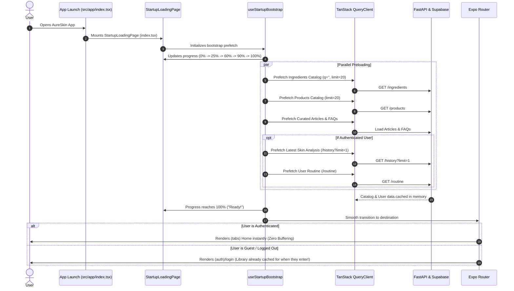

# Implementation Plan: App Startup Loading & Resource Prefetching Screen

**Target Feature:** App Startup / Resource Preloading & Cache Acceleration (`src/features/bootstrap`)  
**Route Integration:** `src/app/index.tsx` & `src/app/_layout.tsx`  
**Document Reference:** `documentation/part2_technical_view.md`  
**Design Reference:** `frontend/design_references/ui_design_reference.md`  
**Theme Tokens:** `frontend/src/shared/theme/index.ts`  
**Tailwind Configuration:** `frontend/tailwind.config.js`  
**Ruleset:** `aureskin-frontend-rules` & `aureskin-screen-architecture-implementation`

---

## 1. Problem Statement & Architecture Diagnosis

### 1.1 The User's Experience
- Ingredients and products take notable time to load on first view.
- When navigating between tabs (Home -> Library -> Routine -> History -> Library), the app repeatedly triggers network requests, showing loading spinners and feeling sluggish.
- Every screen visit queries FastAPI/Supabase anew.

### 1.2 Root Cause Analysis
1. **TanStack Query Default `staleTime: 0`:**
   In `frontend/src/app/_layout.tsx`, `const queryClient = new QueryClient();` uses TanStack Query's default configuration where `staleTime = 0`. This marks all query data as stale immediately upon fetching. When a user switches tabs or a screen regains focus, TanStack Query triggers background/foreground refetches every single time.
2. **Cold Boot Cache State:**
   When the app opens, the in-memory cache is empty. The user hits `Library` or `Routine` with zero cached data, forcing sequential network waterfalls over Wi-Fi/mobile data (`/ingredients`, `/products`, `/history`, `/routine`).
3. **Uncached Public Catalogs:**
   The Skincare Ingredients catalog (hundreds of items), Products catalog, Curated Articles, FAQs, and Guidance Tips rarely change minute-by-minute. Re-requesting them on every tab click is redundant.

### 1.3 The Solution: Two-Pillar Startup Acceleration
To achieve instant, zero-buffering navigation like leading consumer apps (Spotify, Airbnb, Notion):
1. **Pillar A: Startup Preloading Loading Screen (`StartupLoadingPage`):**
   A polished, branded launch screen displayed when the app opens before navigating to Login (or Dashboard if already authenticated). It pre-downloads and warms the cache in parallel while displaying a branded progress animation and rotating status tips.
2. **Pillar B: TanStack Query Cache Configuration & Prolonged Stale Times:**
   Configure `staleTime` (e.g., 24 hours for library catalogs; 15 minutes for user routine/history) and `gcTime` (24 hours). Once preloaded at startup, navigating across tabs is instantaneous (0 ms, 0 spinners).

---

## 2. High-Level Flow & System Architecture



---

## 3. Screen Design & Visual Specifications

The startup loading screen must adhere strictly to `aureskin-frontend-rules` design presets and theme tokens:

| Element | Component / Token | Styling Description |
|---|---|---|
| **Background** | `bg-primary` (`#6B7B4C`) | Rich brand olive green container covering the full device screen (including safe areas). |
| **Status Bar** | `<StatusBar style="light" />` | Light icons on dark olive background. |
| **Branding / Logo** | `Text` with `font-heading text-display text-neutral-white` | "AureSkin" bold typography (32px Outfit). |
| **Tagline** | `Text` with `font-sans-medium text-body-sm text-neutral-white/80` | "Personalized AI Skincare & Analysis" subtitle. |
| **Center Graphic** | Animated Glowing App Icon / Sparkle Ring | Pulsing circular badge (`w-24 h-24 rounded-full bg-secondary/30 items-center justify-center`) with `Sparkles` or `Droplet` icon. |
| **Progress Track** | `View` with `h-2 rounded-full bg-card/25 w-64 overflow-hidden` | Soft translucent track. |
| **Progress Fill** | `Animated.View` with `h-full bg-accent rounded-full` | Smooth animating fill bar driven by native driver or spring physics. |
| **Percentage Label** | `Text` with `text-caption font-sans-bold text-neutral-white` | e.g. "78%". |
| **Rotating Status Tip** | `Text` with `text-caption font-sans text-neutral-white/90` | Rotating friendly status: <br>• *"Connecting to AureSkin service..."*<br>• *"Downloading ingredients library..."*<br>• *"Syncing skincare products..."*<br>• *"Preparing skincare guides..."*<br>• *"Welcome to AureSkin!"* |
| **Fail-Safe Timeout** | 3.5 seconds maximum | If network is slow or offline, graceful fallback proceeds automatically so the user is never stuck. |

---

## 4. Proposed Folder & File Structure

```
frontend/src/
├── app/
│   ├── index.tsx                         <-- Modified: Renders StartupLoadingPage instead of immediate redirect
│   └── _layout.tsx                       <-- Modified: Optimized QueryClient default options (staleTime, gcTime)
│
├── features/
│   └── bootstrap/                        <-- New Feature Module
│       ├── model/
│       │   ├── bootstrap_types.ts        <-- Preload status, step definitions, progress types
│       │   └── bootstrap_api.ts          <-- Prefetch orchestration using queryClient.prefetchQuery
│       ├── viewmodel/
│       │   └── useStartupBootstrap.ts    <-- Manages progress animation, steps ticker, auth routing
│       └── view/
│           ├── StartupLoadingPage.tsx    <-- Main full-screen branded loading page
│           └── components/
│               ├── BootstrapProgressBar.tsx   <-- Animated progress bar component
│               └── BootstrapStatusTicker.tsx  <-- Rotating status message component
│
└── features/library/
    └── viewmodel/
        ├── useIngredients.ts             <-- Updated with staleTime: 24 hours
        └── useProducts.ts                <-- Updated with staleTime: 24 hours
```

---

## 5. Step-by-Step Implementation Details

### Step 1: QueryClient Cache Optimization
**File:** `frontend/src/app/_layout.tsx`
Configure production-grade default options for `QueryClient`:
```typescript
const queryClient = new QueryClient({
  defaultOptions: {
    queries: {
      staleTime: 1000 * 60 * 15, // 15 minutes default stale time for dynamic user data
      gcTime: 1000 * 60 * 60 * 24, // 24 hours garbage collection time (keeps cache in memory)
      refetchOnWindowFocus: false, // Prevent aggressive refetches on app switch
      retry: 1,
    },
  },
});
```

---

### Step 2: Bootstrap Feature Model & Prefetch Orchestrator
**Files:**
- `frontend/src/features/bootstrap/model/bootstrap_types.ts`
- `frontend/src/features/bootstrap/model/bootstrap_api.ts`

**Specifications:**
- `bootstrap_types.ts`:
  ```typescript
  export interface BootstrapStep {
    id: string;
    label: string;
    weight: number; // percentage portion (sums to 100)
  }
  ```
- `bootstrap_api.ts`:
  Orchestrates parallel prefetching into `queryClient`:
  1. **Ingredients:** `queryClient.prefetchInfiniteQuery({ queryKey: ['library', 'ingredients', ''], queryFn: ... })`
  2. **Products:** `queryClient.prefetchInfiniteQuery({ queryKey: ['library', 'products', '', undefined], queryFn: ... })`
  3. **Articles & FAQs:** `queryClient.prefetchQuery({ queryKey: ['home', 'articles'], queryFn: fetchArticles })`
  4. **Guidance Tips:** `queryClient.prefetchQuery({ queryKey: ['scan', 'guidanceTips'], queryFn: getSkinGuidanceTips })`
  5. **If Authenticated:**
     - `queryClient.prefetchQuery({ queryKey: ['history', 'list'], queryFn: ... })`
     - `queryClient.prefetchQuery({ queryKey: ['routine', 'current'], queryFn: ... })`

---

### Step 3: ViewModel Hook (`useStartupBootstrap.ts`)
**File:** `frontend/src/features/bootstrap/viewmodel/useStartupBootstrap.ts`

**Responsibilities:**
- Runs the prefetch tasks on mount.
- Animates a progress value (`0%` -> `100%`) smoothly over a pleasant 1.2s to 2.2s curve so the user perceives a fluid, intentional warmup experience.
- Updates status text dynamically as each resource group finishes downloading.
- Safe Timeout: Guarantees completion within `3500ms` even if an API endpoint times out or device is offline.
- When progress hits 100%:
  - Reads `useAuthStore.getState().isAuthenticated`.
  - Routes cleanly to `/(tabs)` if authenticated, or `/(auth)/login` if not.

---

### Step 4: UI View & Components (`StartupLoadingPage.tsx`)
**Files:**
- `frontend/src/features/bootstrap/view/StartupLoadingPage.tsx`
- `frontend/src/features/bootstrap/view/components/BootstrapProgressBar.tsx`
- `frontend/src/features/bootstrap/view/components/BootstrapStatusTicker.tsx`

**UI Layout:**
1. **Header/Hero Section:**
   - AureSkin brand typography in `font-heading text-display text-neutral-white`.
   - "Personalized AI Skincare" in `text-body-sm font-sans-medium text-neutral-white/80`.
2. **Central Visual:**
   - Elegant leaf/droplet or glowing pulse indicator (`theme.colors.card`).
3. **Bottom Loading Zone:**
   - Rotating status message (`text-caption font-sans text-neutral-white`).
   - Progress bar with smooth `Animated.View` (`bg-accent rounded-full`).
   - Percentage text (`text-caption font-sans-bold text-neutral-white`).

---

### Step 5: Library & Home StaleTime Upgrades
**Files:**
- `frontend/src/features/library/viewmodel/useIngredients.ts`
- `frontend/src/features/library/viewmodel/useProducts.ts`
- `frontend/src/features/home/viewmodel/useHome.ts`

**Modifications:**
- Set `staleTime: 1000 * 60 * 60 * 24` (24 hours) on `useInfiniteQuery` for `['library', 'ingredients']` and `['library', 'products']`.
- Set `staleTime: 1000 * 60 * 60` (1 hour) on `['library', 'ingredient-favorites']` and `['library', 'product-favorites']`.
- When the user opens the Library tab, the data is already warm in `queryClient` memory -> **rendered instantly with 0 ms latency!**

---

### Step 6: Route Integration (`src/app/index.tsx`)
**File:** `frontend/src/app/index.tsx`
Update `index.tsx` to render `<StartupLoadingPage />` instead of an immediate static redirect:
```tsx
import React from 'react';
import { StartupLoadingPage } from '../features/bootstrap/view/StartupLoadingPage';

export default function Index() {
  return <StartupLoadingPage />;
}
```

---

## 6. Token Compliance Checklist (`aureskin-frontend-rules`)

- [x] **No arbitrary font sizes:** Uses `text-display` (32px), `text-h3` (18px), `text-body-sm` (14px), `text-caption` (12px).
- [x] **No arbitrary border radii:** Uses `rounded-card` (16px), `rounded-button` (12px), `rounded-full` (9999px).
- [x] **No hardcoded hex in className:** Uses `bg-primary`, `bg-secondary`, `bg-accent`, `bg-card`, `text-neutral-white`, `border-border`.
- [x] **JS Props Colors:** Imported strictly from `theme.colors.*` (`theme.colors.card`, `theme.colors.accent`).
- [x] **Font Families:** `font-heading` (`Outfit_700Bold`) for logo branding, `font-sans`, `font-sans-medium`, `font-sans-bold`.

---

## 7. Verification & Testing Checklist

- [ ] **Cold Boot Experience:**
  - Launch the app from cold restart.
  - Verify `StartupLoadingPage` renders with dark olive green background (`bg-primary`), AureSkin branding, progress bar, and animated status ticker.
- [ ] **Smooth Preloading:**
  - Verify progress bar animates smoothly from 0% to 100%.
  - Verify status messages rotate cleanly ("Syncing ingredients directory...", "Caching product catalog...", etc.).
- [ ] **Zero-Buffering Tab Navigation:**
  - After startup finishes and enters the app:
    - Tap **Library** tab -> Ingredients list appears **instantly** without skeleton buffering!
    - Tap **Products** tab -> Products list appears **instantly** without skeleton buffering!
    - Switch back and forth between Home, Library, Routine, and History -> zero reloads, zero network lag.
- [ ] **Offline / Network Sluggishness Fallback:**
  - Disconnect or simulate high network latency.
  - Verify the 3.5s fail-safe timer automatically proceeds to the app without hanging or crashing.
- [ ] **Auth State Routing:**
  - When logged out: Startup loads public catalogs, then transitions smoothly to `/(auth)/login`.
  - When logged in: Startup loads catalogs + user data, then transitions smoothly to `/(tabs)`.

