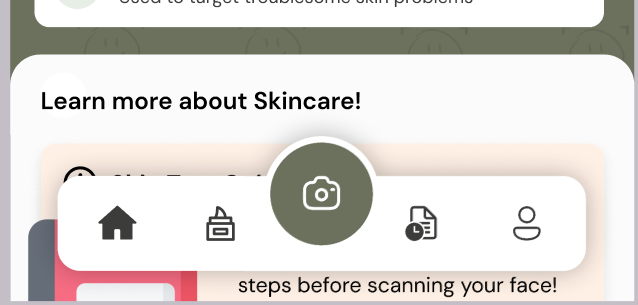
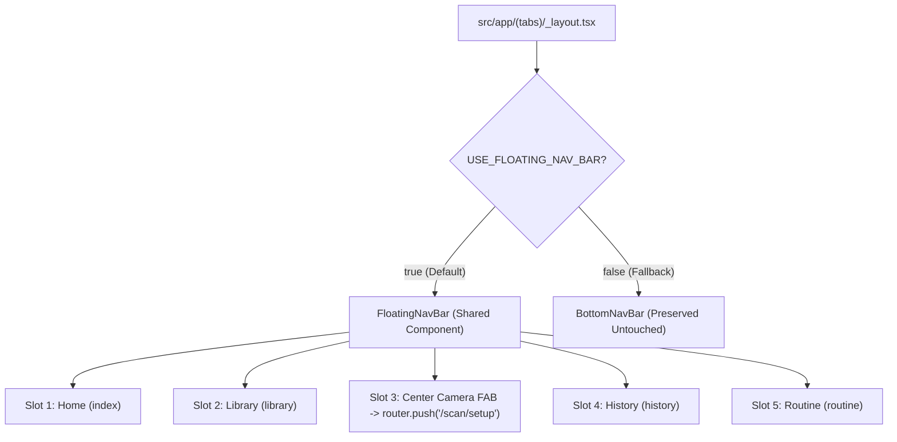

# Implementation Plan: Floating Bottom Navigation Bar (`FloatingNavBar`)

## 1. Overview & Objectives

This plan specifies the architecture, visual design tokens, layout positioning, and integration of a new shared **`FloatingNavBar`** component for AureSkin's primary tab navigation shell (`frontend/src/app/(tabs)/_layout.tsx`).

### Objectives
1. **Create a Separate Shared Component (`FloatingNavBar`)**: Build `frontend/src/shared/components/FloatingNavBar.tsx` as a standalone, drop-in Expo Router tab bar component matching the floating pill aesthetic in Reference Image 1.
2. **Non-Destructive Switch (Preserve `BottomNavBar`)**: Do **not** delete or break the existing fixed `BottomNavBar.tsx`. Keep it fully intact and swap to `FloatingNavBar` via a single boolean toggle in `src/app/(tabs)/_layout.tsx` so reverting or A/B comparing is a one-line change.
3. **Strict `aureskin-frontend-rules` Token Compliance**: Use exclusively design tokens from `frontend/tailwind.config.js` and `frontend/src/shared/theme/index.ts` (zero raw hex values, zero arbitrary border radii, zero generic Tailwind size presets).
4. **Drop Shadow, Rounded Corners & Floating Behavior**: Float above scrollable content with `position: 'absolute'`, `pointerEvents="box-none"` passthrough margins, `rounded-badge` (`20px`) corners, elevated soft drop shadow, and a raised circular primary olive camera button with a crisp white halo border.
5. **Zero Overlap / Full Working Navigation**: Audit and adjust bottom clearance across all 4 main tabs (`Home`, `Library`, `History`, `Routine`)—including lifting the `+ Add Product` floating button in `s2_ProductsTab.tsx`—so no content or controls get trapped behind the floating bar.

---

## 2. Visual Reference & Anatomy



### Visual Breakdown (Matching Reference Image 1)

| Region | Visual Specification | Exact AureSkin Token / Prop |
|---|---|---|
| **Outer Floating Wrapper** | Spans full width at screen bottom; transparent to touches outside the pill | `position: 'absolute'`, `left: 0`, `right: 0`, `bottom: Math.max(insets.bottom, 12)`, `pointerEvents="box-none"`, `px-5` |
| **Floating Pill Container** | Crisp white floating bar with soft rounded corners and diffused elevation drop shadow | `className="flex-row items-center h-16 bg-card rounded-badge px-2"` + iOS/Android drop shadow (`shadowColor: theme.colors.black`, `shadowOffset: { width: 0, height: 6 }`, `shadowOpacity: 0.14`, `shadowRadius: 14`, `elevation: 12`) |
| **Center Scan FAB Halo** | Raised circular white cutout ring seamlessly overlapping the top edge of the bar | `className="h-20 w-20 -mt-5 items-center justify-center rounded-full bg-primary border-4 border-neutral-white"` + subtle shadow (`shadowColor: theme.colors.black`, `elevation: 14`) |
| **Center Scan Icon** | Centered white camera icon inside the olive green circle | `<Camera color={theme.colors.card} size={28} strokeWidth={2.1} />` (from `lucide-react-native`) |
| **4 Tab Slots** | Evenly spaced `flex-1` touch targets (`Home`, `Library`, `History`, `Routine`) | `className="flex-1 h-full items-center justify-center active:opacity-70"` |
| **Tab Icons (Active / Inactive)** | Active tab highlighted with filled weight; inactive tabs crisp outline | Icons from `lucide-react-native`: `Home`, `BookOpen` (or skincare jar SVG), `FileClock`, `User` using `theme.colors.primary` / `theme.colors.text` / `theme.colors.muted` |

> [!NOTE]
> **Strict Border Radius Preset Compliance:** Per `aureskin-frontend-rules`, arbitrary values like `rounded-[24px]` or generic classes like `rounded-2xl` are strictly forbidden. `rounded-badge` (`20px` in `tailwind.config.js`) provides the exact soft floating pill corner radius shown in Reference Image 1 while remaining 100% token-compliant.

---

## 3. Architecture & Navigation Flow



### Key Architectural Contracts
- **Shared Component Location**: `frontend/src/shared/components/FloatingNavBar.tsx`
- **Barrel Export**: Export `FloatingNavBar` and `FloatingNavBarProps` from `frontend/src/shared/components/index.ts`.
- **Props Compatibility**: Accepts the exact same Expo Router `tabBar` prop signature as `BottomNavBarProps` (`Parameters<NonNullable<TabsProps['tabBar']>>[0]`), ensuring zero coupling changes in `(tabs)/_layout.tsx`.
- **Overlay Safety**: Preserves `useAppStore` (`isScanOverlayOpen` / `closeScanOverlay`) handling and Expo Router `tabPress` event emission (`emitter.emit` + `navigateToTab`) identically to `BottomNavBar.tsx`.
- **Android Shadow & Overflow Safety**: On Android, combining `overflow: 'hidden'` on a parent clips the raised circular Scan button and drop shadows. The floating pill container will keep `overflow: 'visible'` (default) so the raised center camera circle rises cleanly above the top edge of the white bar without clipping on both Android and iOS.

---

## 4. Exact Design Token Audit (`aureskin-frontend-rules`)

| Styling Property | Allowed Token Used | Forbidden Pattern Avoided |
|---|---|---|
| Bar surface color | `bg-card` (`#FFFFFF`) | Raw `#FFFFFF` in `StyleSheet.create` |
| Bar corner radius | `rounded-badge` (`20px`) | Arbitrary `rounded-[24px]` or `rounded-2xl` |
| Center FAB surface | `bg-primary` (`#6B7B4C`) | Hardcoded `#6B7B4C` |
| Center FAB ring | `border-4 border-neutral-white` + `rounded-full` | Hardcoded border hex |
| Icon JS colors | `theme.colors.card`, `theme.colors.primary`, `theme.colors.text`, `theme.colors.muted` | Inline hex strings like `color="#2D2D2D"` |
| Shadow JS color | `theme.colors.black` (from `@/shared/theme`) | Hardcoded `'#000000'` |

---

## 5. File-by-File Implementation Plan

### 5.1 Create Shared Component
#### `[NEW]` `frontend/src/shared/components/FloatingNavBar.tsx`
- Export `FloatingNavBar` and `FloatingNavBarProps` (typed from `TabsProps['tabBar']`).
- Outer positioning wrapper:
  - `position: 'absolute'`, `left: 0`, `right: 0`, `bottom: Math.max(insets?.bottom ?? 0, 12)`
  - `pointerEvents="box-none"` so transparent outer gutter areas pass touch events through to scrollable content below.
- Inner floating bar (`View`):
  - `className="mx-5 h-16 flex-row items-center rounded-badge bg-card px-2"`
  - Elevation shadow via inline `style` referencing `theme.colors.black` (no `StyleSheet.create` with raw hexes).
- 5 route items mapped from `state.routes`:
  - **`index` (Home)**: `<Home />` icon — navigates to Home tab.
  - **`library` (Library)**: `<BookOpen />` (or custom skincare jar icon matching Image 1 — see Open Decisions below) — navigates to Library tab.
  - **`scan` (Center Raised Camera Button)**: Raised `h-20 w-20 -mt-5 rounded-full bg-primary border-4 border-neutral-white` circular pressable with `<Camera color={theme.colors.card} size={28} strokeWidth={2.1} />` calling `router.push('/scan/setup')`.
  - **`history` (History)**: `<FileClock />` icon (matches Image 1's document-with-clock glyph) — navigates to History tab.
  - **`routine` (Routine)**: `<User />` icon — navigates to Routine tab.
- Full accessibility props (`accessibilityRole="tab"` / `"button"`, `accessibilityState={{ selected: isFocused }}`, `accessibilityLabel`).

#### `[MODIFY]` `frontend/src/shared/components/index.ts`
- Add named exports:
  ```ts
  export { FloatingNavBar } from './FloatingNavBar';
  export type { FloatingNavBarProps } from './FloatingNavBar';
  ```

### 5.2 Non-Destructive Swap in Tabs Layout
#### `[MODIFY]` `frontend/src/app/(tabs)/_layout.tsx`
- Keep `BottomNavBar` imported and untouched in `src/shared/components/BottomNavBar.tsx`.
- Import `FloatingNavBar` from `../../shared/components/FloatingNavBar`.
- Add a clear feature switch at the top of `_layout.tsx`:
  ```tsx
  // Set to `false` to revert to the legacy fixed BottomNavBar
  const USE_FLOATING_NAV_BAR = true;
  ```
- Pass `tabBar={(props) => (USE_FLOATING_NAV_BAR ? <FloatingNavBar {...props} /> : <BottomNavBar {...props} />)}` to `<Tabs />`.

### 5.3 Bottom Scroll Clearance & FAB Overlap Fixes (Critical Audit Findings)
Because `FloatingNavBar` uses `position: 'absolute'` to float over screen content (as shown in Image 1), screens no longer reserve a fixed `72px` strip at the bottom. An audit of all 4 main tabs identified **3 specific clearance adjustments** required so nothing is obstructed:

| Screen / File | Current State | Required Adjustment | Why |
|---|---|---|---|
| `frontend/src/features/home/view/HomePage.tsx` | `pb-28` (`112px`) | Keep `pb-28` (already cleared) | Sufficient space for `S5FAQs` above floating bar |
| `frontend/src/features/routine/view/RoutinePage.tsx` | `pb-28` (`112px`) | Keep `pb-28` (already cleared) | Sufficient space for bottom routine cards |
| `frontend/src/features/library/view/containers/s1_IngredientsTab.tsx` | `contentContainerClassName="pb-6"` (`24px`) | Update to `contentContainerClassName="pb-28"` | Prevents last ingredient cards from hiding under the floating bar |
| `frontend/src/features/library/view/containers/s2_ProductsTab.tsx` | List has `pb-28`; **`+` Add Product FAB is `bottom-5 right-5`** | Lift `+` FAB to **`bottom-28 right-5`** | Prevents the `+ Add Product` FAB from colliding behind the right side of the floating nav bar! |
| `frontend/src/features/history/view/containers/s1_HistoryList.tsx` | `contentContainerClassName="grow px-4 pb-12 pt-1"` (`48px`) | Update to `contentContainerClassName="grow px-4 pb-28 pt-1"` | Prevents last history entry & pagination footer from hiding under the floating bar |

---

## 6. Design Decisions for Your Review

Before implementing, please confirm your preference on two quick visual details:

1. **Active / Inactive Tab Icon Colors**:
   - **Option A (Recommended — Matches AureSkin Brand & Existing `BottomNavBar`)**: Active icon in **Olive Green (`theme.colors.primary`)** filled, inactive icons in **Muted Gray (`theme.colors.muted`)** outline.
   - **Option B (Exact Reference Image 1 Monochrome)**: Active icon in **Dark Charcoal (`theme.colors.text`)** filled, inactive icons in **Dark Charcoal (`theme.colors.text`)** outline.
2. **Slot 2 (`Library`) & Slot 4 (`History`) Icons**:
   - In Reference Image 1, Slot 2 is a **skincare cream jar** (we can render a clean custom `react-native-svg` icon matching Image 1, or keep `BookOpen`), Slot 3 is **`Camera`** (instead of `Scan`), and Slot 4 is **`FileClock`** (document with clock). Confirm if you want the exact Reference Image 1 icons (`Home`, custom Skincare Jar SVG, `Camera`, `FileClock`, `User`)!

---

## 7. Verification Plan

After implementation, we will verify:
1. **TypeScript Compilation**: Run `cd frontend && npx tsc --noEmit` — must exit with **0 errors**.
2. **Design Token Compliance Check**: Audit `FloatingNavBar.tsx` to verify zero raw hex values, zero arbitrary border radii, and zero `StyleSheet.create` raw colors.
3. **Functional & Visual Verification on Device**:
   - Floating white bar sits centered with rounded corners (`rounded-badge`) and soft drop shadow; underlying page content is visibly scrollable beneath/around it.
   - Center raised olive circular `Camera` button sits cleanly above the top edge with its crisp white ring and opens `/scan/setup`.
   - All 4 tabs (`Home`, `Library`, `History`, `Routine`) navigate accurately, update active icon states, and close any open scan overlay.
   - Bottom items on Home, Library (Ingredients & Products), History, and Routine all scroll cleanly above the floating bar, and the `+ Add Product` FAB on Library Products sits cleanly above the floating bar without overlap.
   - Confirm `BottomNavBar.tsx` remains untouched and switching `USE_FLOATING_NAV_BAR = false` restores the old bar cleanly.

