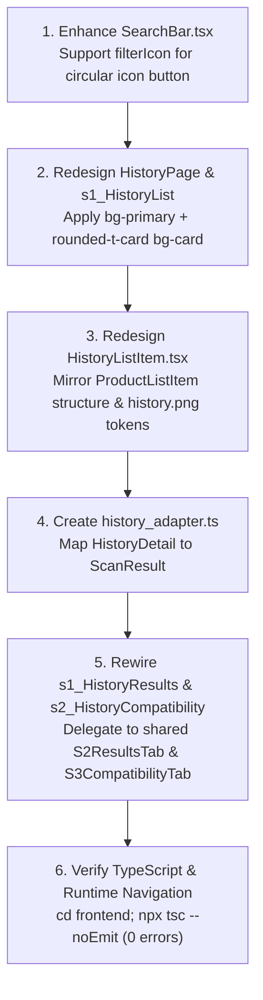

# Architecture & Implementation Plan: History Screen Improvements

## 1. Executive Summary & Objective

The objective of this task is to align the **History Screen** (`HistoryPage.tsx`, `s1_HistoryList.tsx`, and `HistoryListItem.tsx`) with the visual design ground truth in [`frontend/design_references/history.png`](file:///c:/Users/Thea/Documents/DLSUD/AureSkin/frontend/design_references/history.png), mirroring the architectural layout established in the **Library** feature (`rounded-t-card bg-card` white curved container), integrating global `SearchBar` Style 2 with the circular filter button, and rewiring the History Detail preview screens (`s1_HistoryResults` and `s2_HistoryCompatibility`) to consume the newly created shared page components from `@/shared/pages/scan_results/`.

---

## 2. Visual & Structural Design Analysis (Reference: `design_references/history.png`)

```
┌──────────────────────────────────────────────────────────┐
│  ☰  History                                  (AppHeader) │ ← Primary Olive Green (#6B7B4C)
├──────────────────────────────────────────────────────────┤
│ ╭──────────────────────────────────────────────────────╮ │ ← White Card Container (rounded-t-card bg-card)
│ │  [ 🔍 search history            ]   [ 🎛️ (Filter) ]    │ │ ← Fixed Pinned SearchBar (Style 2 with circular icon)
│ │                                                      │ │
│ │  ┌──────────┬─────────────────────────────┬────────┐ │ │
│ │  │          │ May 1, 2026   [98% Healthy] │  ···   │ │ │ ← HistoryListItem (similar to ProductListItem)
│ │  │   Face   ├─────────────────────────────┴────────┤ │ │   - Face Photo Thumbnail (w-24 h-24 rounded-card)
│ │  │   Photo  │ [ Oily ]                             │ │ │   - Date & Solid Green Health Score Badge
│ │  │Thumbnail │ [ Skin Redness ]                     │ │ │   - Solid Secondary Skin Type Pill
│ │  │          │                                      │ │ │   - Solid Coral Skin Condition Pill(s)
│ │  └──────────┴──────────────────────────────────────┘ │ │   - Three Dots (···) Overflow Action Button
│ │                                                      │ │
│ │  ┌──────────┬─────────────────────────────┬────────┐ │ │
│ │  │          │ Month 0, 0000 [00% Healthy] │  ···   │ │ │
│ │  │          │ [ Skin Type ]               │        │ │ │
│ │  │          │ [ Skin Condition ]          │        │ │ │
│ │  └──────────┴─────────────────────────────┴────────┘ │ │
│ ╰──────────────────────────────────────────────────────╯ │
└──────────────────────────────────────────────────────────┘
```

---

## 3. Scope of Work & Architectural Changes

### 3.1 History Page Layout (`HistoryPage.tsx` & `s1_HistoryList.tsx`)
1. **Curved White Container Layout:**
   - Outer wrapper in `HistoryPage.tsx`: `View className="flex-1 bg-primary"`
   - Inner container: `View className="flex-1 rounded-t-card bg-card overflow-hidden"` (identical to `LibraryPage.tsx`).
2. **Pinned SearchBar with Filter Icon Button:**
   - Enhance shared `SearchBar.tsx` with an optional `filterIcon` prop (`filterIcon?: LucideIcon`).
   - When `filterIcon` is provided without `filterLabel`, it renders the search capsule on the left (`flex-1`) and a separate circular filter button on the right (`h-11 w-11 rounded-full border border-border bg-card items-center justify-center`), exactly matching `history.png`.
   - Wired to open `PopUpHistoryFilterPanel`.
3. **Redesigned `HistoryListItem.tsx` (modeled after `ProductListItem`):**
   - Left side: Prominent face photo thumbnail (`w-24 h-24 rounded-card overflow-hidden bg-secondary/15`).
   - Right side:
     - Header row: Clean date string (`text-body-sm font-sans-medium text-text`), solid green health score badge (`px-3 py-1 rounded-badge bg-status-success text-neutral-white text-caption font-sans-bold`), and three-dot button (`···`).
     - Sub-badges: Solid warm beige skin type badge (`bg-secondary px-3 py-0.5 rounded-badge text-neutral-white`), followed by solid coral condition badge (`bg-concern px-3 py-0.5 rounded-badge text-neutral-white`).

### 3.2 Detail Preview Screen Rewiring (`HistoryDetailPage.tsx`)
1. Create a lightweight adapter `historyDetailToScanResult(detail: HistoryDetail): ScanResult` in `features/history/model/history_adapter.ts` to bridge `HistoryDetail` to `ScanResult`.
2. Update `s1_HistoryResults.tsx`:
   - Replace legacy custom hero & condition cards with `<S2ResultsTab scanResult={scanResult} imageUri={detail.image_url || ''} isRefreshing={isRefreshing} onRefresh={onRefresh} />` from `@/shared/pages/scan_results/containers/s2_ResultsTab`.
3. Update `s2_HistoryCompatibility.tsx`:
   - Replace legacy custom ingredient lists with `<S3CompatibilityTab scanResult={scanResult} isRefreshing={isRefreshing} onRefresh={onRefresh} />` from `@/shared/pages/scan_results/containers/s3_CompatibilityTab`.

### 3.3 Obsolete Component Audit
With the preview tabs delegating directly to `@/shared/pages/scan_results/`, the following 4 local components in `frontend/src/features/history/view/components/` become completely unused:
1. `HistoryAnalysisHero.tsx` (Replaced by `FacePhotoCard`, `HealthScoreCard`, and `SkinTypeBanner` from shared scan_results)
2. `HistoryConditionCard.tsx` (Replaced by `ConditionsCard` from shared scan_results)
3. `CompatibleIngredientItem.tsx` (Replaced by `S3CompatibilityTab` from shared scan_results)
4. `IncompatiblePairCard.tsx` (Replaced by `S3CompatibilityTab` from shared scan_results)

*These 4 files will be earmarked for deletion after user confirmation.*

The following components **remain active**:
1. `HistoryListItem.tsx` (Redesigned list item row)
2. `HistoryDetailHeader.tsx` (Top timestamped header & Results/Compatibility tab switcher)
3. `HistoryEntryActionSheet.tsx` (Delete confirmation sheet triggered by "···")
4. `PopUpHistoryFilterPanel.tsx` / `HistoryFilterSheet.tsx` (Filter panel triggered by the filter button)

---

## 4. Step-by-Step Implementation Workflow



### Step 1: Enhance Shared `SearchBar.tsx`
- Add `filterIcon?: LucideIcon` to `SearchBarProps`.
- In `style === 2`, when `filterIcon` is provided, render the search capsule on the left and the circular filter icon button on the right matching `history.png`.

### Step 2: Redesign `HistoryPage.tsx` and `s1_HistoryList.tsx`
- Set `HistoryPage.tsx` outer background to `bg-primary`, with inner body wrapped in `rounded-t-card bg-card`.
- In `s1_HistoryList.tsx`, permanently pin the style 2 `SearchBar` with `filterIcon={SlidersHorizontal}`.
- Wire `onFilterPress` to `props.onOpenFilters()`.

### Step 3: Redesign `HistoryListItem.tsx`
- Rebuild layout based on `ProductListItem.tsx` and `history.png`:
  - `w-24 h-24 rounded-card overflow-hidden bg-secondary/15` image container.
  - Formatted date (`text-body-sm font-sans-medium text-text`).
  - Solid green badge (`bg-status-success text-neutral-white font-sans-bold text-caption`).
  - Three dots (`MoreHorizontal`) for overflow actions.
  - Solid skin type pill (`bg-secondary text-neutral-white font-sans-medium text-caption`).
  - Solid condition pill (`bg-concern text-neutral-white font-sans-medium text-caption`).

### Step 4: Create History Adapter & Rewire Detail Screens
- Create `frontend/src/features/history/model/history_adapter.ts`:
  - Implements `historyDetailToScanResult(detail: HistoryDetail): ScanResult`.
- Update `s1_HistoryResults.tsx`:
  - Consumes `S2ResultsTab` from `@/shared/pages/scan_results/containers/s2_ResultsTab`.
- Update `s2_HistoryCompatibility.tsx`:
  - Consumes `S3CompatibilityTab` from `@/shared/pages/scan_results/containers/s3_CompatibilityTab`.
- Update `HistoryDetailPage.tsx` to pass `detail` cleanly.

### Step 5: Verification & User Decision on Obsolete Components
- Run `cd frontend; npx tsc --noEmit` to verify type safety across the entire application.
- Present the list of 4 obsolete components (`HistoryAnalysisHero`, `HistoryConditionCard`, `CompatibleIngredientItem`, `IncompatiblePairCard`) for the user to confirm deletion.

---

## 5. Design Token & Rule Compliance Audit

| Requirement | Token / Rule |
|---|---|
| **Colors** | Strictly `bg-primary`, `bg-card`, `border-border`, `text-text`, `text-muted`, `bg-secondary`, `bg-concern`, `bg-status-success`, `text-neutral-white`. No raw hex codes. |
| **Typography** | Strictly `text-body-sm`, `text-caption`, `text-label`, `font-sans`, `font-sans-medium`, `font-sans-bold`. |
| **Border Radii** | Strictly `rounded-card` (16px), `rounded-button` (12px), `rounded-badge` (20px), `rounded-full` (9999px), `rounded-t-card`. |
| **Component Architecture** | Adheres to MVVM; shared components are cleanly consumed from `@/shared/pages/scan_results/`. |

