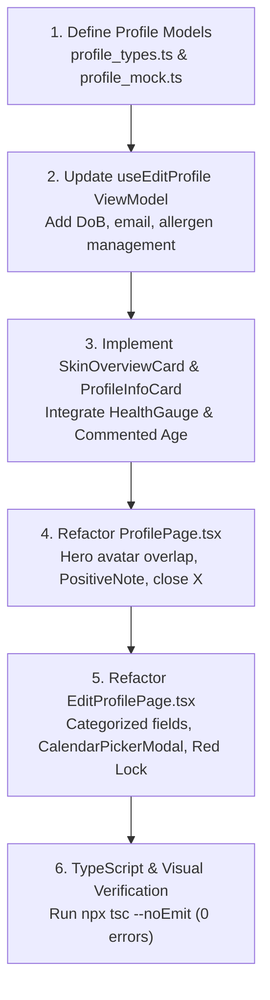

# Architecture & Implementation Plan: Profile & Edit Profile Screen Improvements

## 1. Executive Summary & Objectives

The objective of this task is to refactor and align the **Profile Page** (`ProfilePage.tsx`) and **Edit Profile Page** (`EditProfilePage.tsx`) with the target visual reference images, adhering strictly to the **AureSkin Design System** (`aureskin-frontend-rules`), MVVM architecture, and specific user guidelines:

1. **Profile Page (Image 1 Ground Truth):**
   - **Header Banner:** Olive green (`bg-primary`) top section with user greeting (`"Hello, Cathy!"`), `"Edit Profile"` pill button, top-right close `X` button, and circular avatar with cream border overlapping the curved card container below.
   - **Skin Overview Card:** Display `"SKIN TYPE"` (`"Oily"`), `"SKIN CONDITION/S"` (`"Skin Condition"` in `bg-concern` coral badge), and integrated circular animated `HealthGauge` (`percentage={89}`, `sublabel="Healthy"`).
   - **Profile Information Card:**
     - **Omit Pregnant container** completely.
     - **Age container:** Implement with calendar icon and `"20 years old"` display, but **keep it commented out** in code for now.
     - **Allergen container:** Display leaf/plant icon, title `"Allergen"`, subtext, current value (`"None"`), and chevron link.
   - **Privacy Callout:** Utilize the shared `PositiveNote` component (Style 1) with shield check badge for `"Your Information is Safe"`, updating the description with clear, relevant data protection and encrypted skin health records messaging.

2. **Edit Profile Page (Image 2 Ground Truth):**
   - **Header Section:** Olive green top area with curved white sheet (`rounded-t-card bg-card`), centered avatar overlapping the boundary with a floating circular edit pencil badge (`Pencil` icon in `bg-primary`).
   - **Page Heading:** `"Edit Profile"` in `text-h1` / `text-h2 font-sans-bold text-text`.
   - **Logical Field Categorization & Label Organization:**
     - **GENERAL INFORMATION:** First Name, Last Name, Username, and **Date of Birth** (interactive field triggering `CalendarPickerModal`).
     - **ACCOUNT & CONTACT:** **Email Address** field.
     - **SKIN & HEALTH PROFILE (replacing `[INFORMATION SOMETHING]`):** Allergen picker/dropdown with tag chips and selection modal/presets.
     - *Suggested Additional Fields for User Review:* Gender/Pronouns and Skin Goals / Concerns.
   - **Password Action:** Prominent full-width `"Change Password"` pill button with red outline and red lock icon (`border-status-error text-status-error`).
   - **Bottom Dual Actions:** Horizontal button row with `"Cancel"` (`border-border`) and `"Save Changes"` (`bg-primary text-neutral-white`).

---

## 2. Visual & Structural Design Analysis

### 2.1 Profile Page (`ProfilePage.tsx`)

```
┌──────────────────────────────────────────────────────────────┐
│ [Avatar 100x100]    Hello, Cathy!                        ✕   │ ← bg-primary (Olive Green)
│   (Beige Border)    [ Edit Profile ]                         │
├──────────────────────────────────────────────────────────────┤
│ ╭──────────────────────────────────────────────────────────╮ │ ← rounded-t-card bg-neutral-offwhite
│ │ ┌──────────────────────────────────────────────────────┐ │ │
│ │ │ Skin Overview                                        │ │ │ ← Skin Overview Card (bg-card)
│ │ │ SKIN TYPE                     ╭────────────╮         │ │ │   - HealthGauge 89% Healthy
│ │ │ Oily                          │   89%      │         │ │ │   - Skin Type & Coral Condition
│ │ │                               │  Healthy   │         │ │ │
│ │ │ SKIN CONDITION/S              ╰────────────╯         │ │ │
│ │ │ [ Skin Condition ]                                   │ │ │
│ │ └──────────────────────────────────────────────────────┘ │ │
│ │                                                          │ │
│ │ ┌──────────────────────────────────────────────────────┐ │ │
│ │ │ Profile Information                                  │ │ │ ← Profile Information Card
│ │ │ This information helps us personalize your skincare. │ │ │
│ │ │                                                      │ │ │
│ │ │ /* [📅] Age   20 years old  > */ (COMMENTED OUT)     │ │ │
│ │ │                                                      │ │ │
│ │ │  [🌾] Allergen               None                 >  │ │ │ ← Allergen Row Box
│ │ └──────────────────────────────────────────────────────┘ │ │
│ │                                                          │ │
│ │ ┌──────────────────────────────────────────────────────┐ │ │
│ │ │ 🛡️  Your Information is Safe                         │ │ │ ← PositiveNote (Style 1)
│ │ │    We keep your data private and secure...           │ │ │
│ │ └──────────────────────────────────────────────────────┘ │ │
│ ╰──────────────────────────────────────────────────────────╯ │
└──────────────────────────────────────────────────────────────┘
```

### 2.2 Edit Profile Page (`EditProfilePage.tsx`)

```
┌──────────────────────────────────────────────────────────────┐
│                                                              │ ← bg-primary Header
│                      ╭──────────────╮                        │
│                      │    Avatar    │                        │ ← Avatar overlapping container
│                      │   [Pencil]   │                        │
├──────────────────────╰──────────────╯────────────────────────┤
│ ╭──────────────────────────────────────────────────────────╮ │ ← rounded-t-card bg-card
│ │ Edit Profile                                             │ │
│ │                                                          │ │
│ │ GENERAL INFORMATION                                      │ │
│ │ First Name                                               │ │
│ │ [ Cathy                                                ] │ │
│ │ Last Name                                                │ │
│ │ [ Reyes                                                ] │ │
│ │ Username                                                 │ │
│ │ [ @cathyreyes_20                                       ] │ │
│ │ Date of Birth                                            │ │
│ │ [ 2004-05-15                             📅            ] │ │ ← Triggers CalendarPickerModal
│ │                                                          │ │
│ │ ACCOUNT & CONTACT                                        │ │
│ │ Email Address                                            │ │
│ │ [ cathy.reyes@example.com                              ] │ │
│ │                                                          │ │
│ │ SKIN & HEALTH PROFILE                                    │ │
│ │ Allergen                                                 │ │
│ │ [ Select or add allergens                      ▼       ] │ │
│ │                                                          │ │
│ │ ╭──────────────────────────────────────────────────────╮ │ │
│ │ │ 🔒  Change Password                                  │ │ │ ← Red outline pill button
│ │ ╰──────────────────────────────────────────────────────╯ │ │
│ │                                                          │ │
│ │ [       Cancel       ]    [     Save Changes     ]       │ │ ← Dual action buttons
│ ╰──────────────────────────────────────────────────────────╯ │
└──────────────────────────────────────────────────────────────┘
```

---

## 3. Detailed Component & Token Specifications

### 3.1 Profile Page Components

| Component / Section | Design Tokens & Tailwind Classes | Details & Props |
|---|---|---|
| **Header Banner** | `bg-primary pt-12 pb-16 px-5 relative` | Olive green container (`#6B7B4C`), accommodates status bar and top-right close `X` button. |
| **Close Button** | `absolute top-12 right-5 w-10 h-10 items-center justify-center` | `X` icon in `theme.colors.card` (white), `router.back()`. |
| **Avatar Hero Block** | `flex-row items-center gap-4` | Avatar: `w-24 h-24 rounded-full border-2 border-neutral-border bg-card shadow-sm`. Overlaps bottom card boundary. |
| **User Greeting** | `text-h1 font-sans-bold text-neutral-white` | `"Hello, Cathy!"` (or `user.displayName`). |
| **Edit Profile Pill** | `bg-card/25 rounded-full px-3.5 py-1.5 self-start active:opacity-80` | Text: `text-caption font-sans-medium text-neutral-white`. Navigates to `/edit-profile`. |
| **Curved Sheet** | `rounded-t-card bg-neutral-offwhite flex-1 -mt-8 pt-6 px-4` | Smooth curved transition separating hero from content. |
| **Skin Overview Card** | `rounded-card border border-border bg-card p-5 mb-4 shadow-xs` | Primary summary card. |
| - Card Title | `text-body font-sans-bold text-secondary mb-3` | `"Skin Overview"` |
| - Skin Type Label | `text-caption font-sans-bold text-muted uppercase tracking-wider` | `"SKIN TYPE"` |
| - Skin Type Value | `text-h2 font-sans-bold text-text mt-0.5` | `"Oily"` |
| - Condition Label | `text-caption font-sans-bold text-muted uppercase tracking-wider mt-3` | `"SKIN CONDITION/S"` |
| - Condition Badge | `bg-concern px-3 py-1 rounded-badge self-start mt-1.5` | Text: `text-caption font-sans-bold text-neutral-white`, e.g. `"Skin Condition"`. |
| - Health Gauge | `HealthGauge` component | Props: `percentage={89}`, `size={84}`, `strokeWidth={8}`, `color={theme.colors.accent}`, `showSublabel={true}`, `sublabel="Healthy"`. |
| **Profile Info Card** | `rounded-card border border-border bg-card p-5 mb-4 shadow-xs` | Container for personal details. |
| - Title & Subtitle | `text-body font-sans-bold text-secondary` & `text-caption font-sans text-muted mt-1 mb-4` | `"Profile Information"` & explanatory subtitle. |
| - **Age Container** *(Commented Out)* | `rounded-card border border-border bg-card p-3.5 mb-3 flex-row items-center justify-between` | Left: `w-11 h-11 rounded-full bg-primary` with `CalendarDays` icon. Center: `"Age"`, subtext. Right: `"20"` & `"years old"`. |
| - **Pregnant Container** | *OMITTED* | Excluded completely per user specification. |
| - **Allergen Container** *(Active)* | `rounded-card border border-border bg-card p-3.5 flex-row items-center justify-between` | Left: `w-11 h-11 rounded-full bg-primary` with `Sprout` / `AlertCircle` icon. Center: `"Allergen"`, subtext. Right: `"None"` + `ChevronRight`. |
| **Privacy Note** | `PositiveNote` component | `<PositiveNote style={1} title="Your Information is Safe" description="We protect your personal data and skin health records. Your information is encrypted and strictly used to personalize your skincare insights." />` |

---

### 3.2 Edit Profile Page Components

| Component / Section | Design Tokens & Tailwind Classes | Details & Props |
|---|---|---|
| **Header Banner** | `bg-primary pt-12 pb-16 items-center justify-center relative` | Olive green top banner. |
| **Avatar Picker Container** | `relative -mt-14 self-center` | Overlaps top banner and lower card container. |
| - Avatar Image | `w-28 h-28 rounded-full border-4 border-card bg-card shadow-md` | Shows active `avatarUri` or placeholder image. |
| - Pencil Badge | `absolute bottom-0 right-1 w-9 h-9 rounded-full bg-primary border-2 border-card items-center justify-center active:opacity-80` | `Pencil` icon in white (`size={16}`). Triggers `ImagePicker`. |
| **Curved Card Sheet** | `flex-1 rounded-t-card bg-card px-5 pt-4 pb-8` | White main body sheet. |
| **Page Title** | `text-h1 font-sans-bold text-text mb-5` | `"Edit Profile"` |
| **Category 1: GENERAL INFORMATION** | `text-caption font-sans-bold text-secondary uppercase tracking-wider mb-2` | First Name, Last Name, Username, Date of Birth. |
| - Input Fields | `rounded-input bg-neutral-offwhite border border-border/60 px-4 py-3 text-body-sm font-sans text-text mb-3.5` | Standardized text inputs with `placeholderTextColor={theme.colors.muted}`. |
| - **Date of Birth Field** | `rounded-input bg-neutral-offwhite border border-border/60 px-4 py-3 flex-row items-center justify-between mb-3.5` | Displays selected date string (or `"Select Date"`). Trailing `Calendar` icon in `theme.colors.muted`. Opens `CalendarPickerModal`. |
| **Category 2: ACCOUNT & CONTACT** | `text-caption font-sans-bold text-secondary uppercase tracking-wider mb-2 mt-4` | Email Address. |
| - Email Input | `rounded-input bg-neutral-offwhite border border-border/60 px-4 py-3 text-body-sm font-sans text-text mb-3.5` | `keyboardType="email-address"`, `autoCapitalize="none"`. |
| **Category 3: SKIN & HEALTH PROFILE** | `text-caption font-sans-bold text-secondary uppercase tracking-wider mb-2 mt-4` | Replaces `[INFORMATION SOMETHING]`. |
| - Allergen Dropdown | `rounded-input bg-neutral-offwhite border border-border/60 px-4 py-3 flex-row items-center justify-between` | Displays selected allergen or picker trigger with `ChevronDown`. Supports tag list chips for active allergens. |
| **Change Password Pill** | `w-full rounded-full border border-status-error bg-card py-3.5 my-5 flex-row items-center justify-center gap-2 active:opacity-80` | Red outline button with `Lock` icon and `"Change Password"` in `text-status-error font-sans-semibold text-label`. |
| **Dual Action Buttons** | `flex-row items-center gap-3 mt-2 mb-6` | Horizontal row pinning Cancel and Save Changes. |
| - Cancel Button | `flex-1 rounded-button border border-border bg-card py-3.5 items-center justify-center active:bg-neutral-offwhite` | `"Cancel"` in `text-label font-sans-semibold text-text`. |
| - Save Changes Button | `flex-1 rounded-button bg-primary py-3.5 items-center justify-center active:opacity-90` | `"Save Changes"` in `text-label font-sans-semibold text-neutral-white`. |

---

## 4. Suggested Additional Fields for General & Health Profile

To address the user's request:
> *"can you organize the labels into something more fitting. you can organize fields too on which category they should be. add date of birth and email fields too. you can suggest general information for additional fields and ill check them"*

Here are proposed optional fields structured logically:

### 1. Category: General Information
- **First Name** (Active)
- **Last Name** (Active)
- **Username** (Active)
- **Date of Birth** (Active - replaces manual age input and automatically derives the user's age via `CalendarPickerModal`)
- **Gender** (Active - Female, Male, Non-binary, Prefer not to say pill selector)

### 2. Category: Account & Contact
- **Email Address** (Active)
- **Phone Number** (Active - SMS contact and recovery)

### 3. Category: Skin & Health Profile
- **Allergen(s)** (Active - dropdown capsule, common preset pills, custom tag additions)

*(Note: Per user feedback, Account Creation Date, Skin Goals, and Skin Sensitivity Level were excluded to maintain clean and focused simplicity).*

---

## 5. Architecture & File Structure (MVVM)

```
frontend/src/features/profile/
├── model/
│   ├── profile_types.ts          # UserProfile, ProfileDraft, AllergenOption types
│   └── profile_mock.ts           # Mock profile data for preview/development
├── viewmodel/
│   └── useEditProfile.ts         # Draft state, validation, date picker, photo picker
└── view/
    ├── ProfilePage.tsx           # Profile overview screen
    ├── EditProfilePage.tsx       # Profile edit screen
    └── components/
        ├── SkinOverviewCard.tsx  # Skin type, conditions, HealthGauge widget
        └── ProfileInfoCard.tsx   # Allergen row (+ commented-out Age row)
```

---

## 6. Implementation Steps & Verification Plan



### Step 1: Profile Types & Mock Data
- Create `src/features/profile/model/profile_types.ts` defining `UserProfile` and `EditProfileDraft`.
- Create `src/features/profile/model/profile_mock.ts` with default values matching the reference images ("Cathy Reyes", "@cathyreyes_20", "2004-05-15", "cathy.reyes@example.com", "Oily", 89% score).

### Step 2: ViewModel Enhancements (`useEditProfile.ts`)
- Update `EditProfileDraft` to include `dateOfBirth` (YYYY-MM-DD), `email`, `gender`, and `allergens`.
- Add handlers for date selection via `CalendarPickerModal`.
- Support allergen selection and tag removals.

### Step 3: Profile Page Modular Components (`ProfilePage.tsx`)
- Extract `SkinOverviewCard.tsx` with `HealthGauge` (89%, Healthy, accent ring).
- Extract `ProfileInfoCard.tsx` containing the Allergen row, with the Age row present in code but commented out. Omit pregnant container.
- Integrate `PositiveNote` Style 1 at the bottom.

### Step 4: Edit Profile Screen Implementation (`EditProfilePage.tsx`)
- Layout top avatar with pencil badge overlapping white card sheet.
- Implement the 3 categories:
  - `GENERAL INFORMATION`: First Name, Last Name, Username, Date of Birth.
  - `ACCOUNT & CONTACT`: Email Address.
  - `SKIN & HEALTH PROFILE`: Allergen dropdown / chips.
- Add red outline "Change Password" button with lock icon.
- Add bottom dual actions "Cancel" and "Save Changes".

### Step 5: Verification & Testing
- Run `cd frontend; npx tsc --noEmit` to verify 0 type errors.
- Confirm full compliance with `aureskin-frontend-rules` design presets and color tokens.

