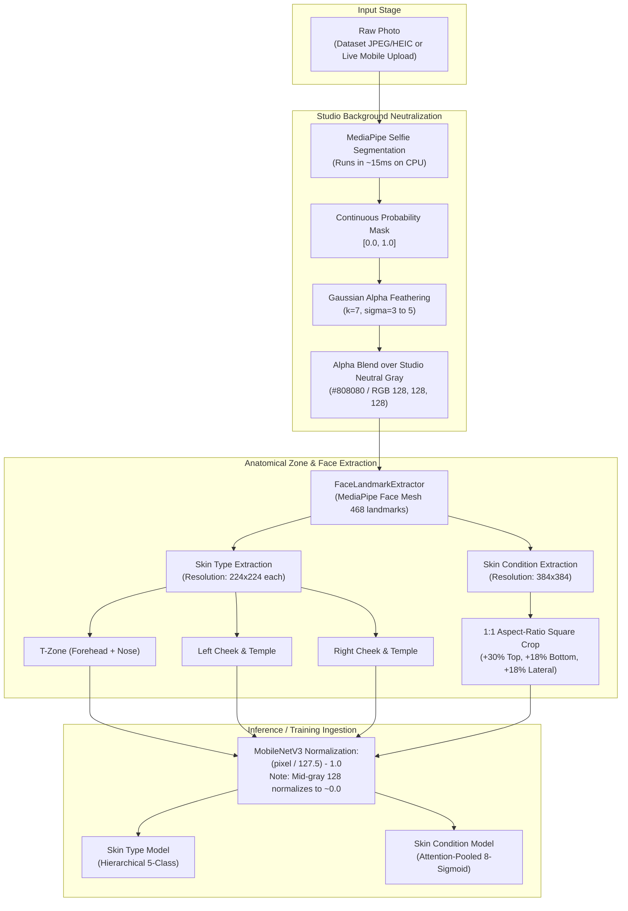

# Implementation Plan: Studio Background Neutralization & Preprocessing Alignment (Dataset & Backend ML)

## 1. Executive Summary & Objective

### 1.1 Context & Problem Statement
During visual inspection of preprocessed crops (e.g. `U001_trip2_aug0.jpg`), the skin type cheek crops and skin condition face crops capture the participant's full lateral facial profile (temples, eye, cheek, jawline, and ear). However, because the crops are wide, square, and unmasked, they inevitably capture 30% to 40% of the **external room/building background** (glass doors, text, outdoor pillars, daylight reflections, and clothing collars).

This causes two major machine learning risks:
1. **Shortcut Learning (Clever Hans Effect):** The neural network correlates background architecture, daylight, or wall colors with specific skin types and conditions (e.g., outdoor hallway = oily; indoor beige wall = dry).
2. **Specular Glare Confusion:** Bright daylight reflections on background windows interfere with the model's optical sheen calculations, misclassifying matte skin as oily.
3. **Training-Serving Skew:** If the training dataset and the live FastAPI backend inference engine use different cropping dimensions, padding ratios, or background treatments, real-world mobile app performance degrades.

### 1.2 Proposed Resolution
Implement a **Studio Neutral Mid-Gray Background Processor (`#808080`)** using **MediaPipe Selfie Segmentation** with soft Gaussian alpha-feathering across both:
1. **The Offline Dataset Preprocessing Pipeline** ([`model_training/scripts/new_preprocess_dataset.py`](file:///c:/Users/Thea/Documents/DLSUD/AureSkin/model_training/scripts/new_preprocess_dataset.py))
2. **The Real-Time FastAPI Backend ML Engine** ([`backend/ml/preprocessor.py`](file:///c:/Users/Thea/Documents/DLSUD/AureSkin/backend/ml/preprocessor.py))

### 1.3 Key Dimensional Contracts
- **Skin Type Model:** $3 \times (224 \times 224 \times 3)$ zone crops (`t_zone`, `left_cheek`, `right_cheek`) extracted from the studio-neutral image. (Full temple, jawline, and lateral profile preserved; background outdoor hallway/room eliminated).
- **Skin Condition Model:** $1 \times (384 \times 384 \times 3)$ square crop (`make_square=True`, +30% top hairline, +18% bottom chin, +18% lateral temples) extracted from the studio-neutral image.

---

## 2. Proposed Architecture & Data Flow



---

## 3. Detailed Step-by-Step Implementation Changes

### Step 1: Update Offline Preprocessor (`model_training/scripts/new_preprocess_dataset.py`)

1. **Add `StudioBackgroundProcessor` Class:**
   ```python
   class StudioBackgroundProcessor:
       def __init__(self, mode: str = "studio_gray", bg_color: int = 128):
           self.mode = mode
           self.bg_color = bg_color
           self.segmenter = None
           if HAS_MEDIAPIPE:
               try:
                   self.segmenter = mp.solutions.selfie_segmentation.SelfieSegmentation(model_selection=0)
               except Exception:
                   self.segmenter = None

       def apply_background(self, img_rgb: np.ndarray) -> np.ndarray:
           if self.segmenter is None:
               return img_rgb
           results = self.segmenter.process(img_rgb)
           if results.segmentation_mask is None:
               return img_rgb
           
           # Soft Gaussian feathering (eliminates sharp boundary contrast steps)
           raw_mask = results.segmentation_mask
           soft_mask = cv2.GaussianBlur(raw_mask, (7, 7), 0)
           soft_mask_3c = np.stack([soft_mask] * 3, axis=-1)
           
           # Neutral studio gray (128, 128, 128)
           bg = np.full_like(img_rgb, self.bg_color, dtype=np.uint8)
           return (img_rgb * soft_mask_3c + bg * (1.0 - soft_mask_3c)).astype(np.uint8)
   ```
2. **Integrate Background Neutralization at Image Load Time:**
   - In `process_skin_type()`: Apply `self.bg_processor.apply_background(fnt_img)` and `apply_background(side_img)` immediately after decoding.
   - In `process_skin_condition()`: Apply `self.bg_processor.apply_background(img_rgb)` immediately after decoding.
   - This ensures all downstream crops (`t_zone`, `left_cheek`, `right_cheek`, and `condition_face`) inherit the clean studio backdrop automatically.
3. **Add CLI Option:**
   - Add `--no_bg_removal` flag (defaults to background removal enabled).

---

### Step 2: Update Backend Inference Preprocessor (`backend/ml/preprocessor.py`)

1. **Add Singleton Selfie Segmenter:**
   - Define `_selfie_segmenter_instance = None` alongside `_face_mesh_instance`.
   - Implement `_get_selfie_segmenter()`.
2. **Apply Studio Background Neutralization in `preprocess_image()`:**
   - Process image bytes $\to$ decode BGR $\to$ convert RGB.
   - Run `_apply_studio_background(img_rgb)` before extracting landmarks and zones.
3. **Align Condition Crop Resolution & Padding with Dataset:**
   - Update condition full-face crop resolution to **$384 \times 384$** (matching `new_preprocess_dataset.py`).
   - Implement the identical aspect-ratio safe square bounding box (+30% top hairline, +18% bottom chin, +18% lateral temples, `make_square=True`).
4. **Preserve Skin Type Inputs:**
   - Retain $224 \times 224$ for `t_zone_input`, `left_cheek_input`, `right_cheek_input`.

---

### Step 3: Verification & Visual Inspection Plan

1. **Verify Offline Dataset Preprocessor:**
   - Run: `python model_training/scripts/new_preprocess_dataset.py --target all --condition_size 384`
   - Inspect:
     - `model_training/preprocessed_dataset/inspections/type_crops_verification/` (Verify left/right cheeks retain temple and jawline while outdoor building background is replaced with neutral gray).
     - `model_training/preprocessed_dataset/inspections/condition_crops_verification/` (Verify full face is preserved against neutral studio gray backdrop).
2. **Verify Backend Preprocessor:**
   - Run unit test comparing raw input image bytes against `preprocess_image()` output shapes:
     - `zone_input["t_zone_input"].shape == (1, 224, 224, 3)`
     - `zone_input["left_cheek_input"].shape == (1, 224, 224, 3)`
     - `zone_input["right_cheek_input"].shape == (1, 224, 224, 3)`
     - `full_input.shape == (1, 384, 384, 3)`

---

## 4. File Modification Matrix

| File Path | Action | Description |
|---|---|---|
| [`model_training/scripts/new_preprocess_dataset.py`](file:///c:/Users/Thea/Documents/DLSUD/AureSkin/model_training/scripts/new_preprocess_dataset.py) | **Update** | Add `StudioBackgroundProcessor` with MediaPipe Selfie Segmentation; neutralize background on image load. |
| [`backend/ml/preprocessor.py`](file:///c:/Users/Thea/Documents/DLSUD/AureSkin/backend/ml/preprocessor.py) | **Update** | Add `_get_selfie_segmenter()`, apply neutral background during live scan, upgrade condition crop to $384 \times 384$ aspect-ratio safe square. |
| [`frontend/implementation_plans/page/skin_preprocessing_and_backend_ml_update_plan.md`](file:///c:/Users/Thea/Documents/DLSUD/AureSkin/frontend/implementation_plans/page/skin_preprocessing_and_backend_ml_update_plan.md) | **Create** | Project implementation plan record (this file). |
| [`model_training/SKIN_CONDITION_TRAINING_LOG.md`](file:///c:/Users/Thea/Documents/DLSUD/AureSkin/model_training/SKIN_CONDITION_TRAINING_LOG.md) | **Update** | Append background neutralization details and dimensional contracts to the training log. |
| [`documentation/skin_condition_training_log.md`](file:///c:/Users/Thea/Documents/DLSUD/AureSkin/documentation/skin_condition_training_log.md) | **Update** | Mirrored copy of condition training log. |
| [`backend/ml/loader.py`](file:///c:/Users/Thea/Documents/DLSUD/AureSkin/backend/ml/loader.py) | **Update** | Added `custom_objects` support when loading condition model for v3 deserialization compatibility. |

---

## 5. Risk Assessment & Mitigations

| Risk | Impact | Mitigation |
|---|---|---|
| **Segmentation Mask Clipping Ears or Hair** | Moderate | Apply Gaussian blur ($\sigma=5$) and threshold feathering so edges smoothly blend into mid-gray without cutting off anatomical edges. |
| **Backend Latency Spike** | Low | MediaPipe Selfie Segmentation runs in $\approx 12-15\text{ms}$ on CPU, well within the $<100\text{ms}$ preprocessing target. |
| **Model Ingestion Shape Mismatch** | High | `new_train_skin_condition.py` defaults to `--img_size 384`, perfectly matching `new_preprocess_dataset.py` and `backend/ml/preprocessor.py`. |

---

## 6. Implementation & Verification Status

- [x] **Step 1: Offline Preprocessor (`model_training/scripts/new_preprocess_dataset.py`)** — Completed & Verified.
  - `StudioBackgroundProcessor` implemented with MediaPipe Selfie Segmentation and Gaussian alpha feathering.
  - Background neutralization integrated at image load time for both `process_skin_type()` and `process_skin_condition()`.
  - Added `--no_bg_removal` CLI flag.
- [x] **Step 2: Backend Inference Preprocessor (`backend/ml/preprocessor.py`)** — Completed & Verified.
  - Added singleton `_get_selfie_segmenter()` and `_apply_studio_background()`.
  - Condition face crop upgraded to $384 \times 384$ aspect-ratio safe square with generous anatomical margins (+30% top, +18% bottom, +18% lateral).
  - Skin type zone inputs retained at $224 \times 224$ for `t_zone`, `left_cheek`, `right_cheek`.
- [x] **Step 3: Backend Model Loader (`backend/ml/loader.py`)** — Completed & Verified.
  - Passes `custom_objects` (with `SpatialAttentionPooling`) when loading `skin_condition_model` so `v3` models deserialize smoothly.
- [x] **Step 4: End-to-End Pipeline Verification (`scratch/test_preprocessors.py`)** — Passed with zero errors.
  - Output tensor dimensions verified:
    * `t_zone_input`: `(1, 224, 224, 3)`
    * `left_cheek_input`: `(1, 224, 224, 3)`
    * `right_cheek_input`: `(1, 224, 224, 3)`
    * `full_input`: `(1, 384, 384, 3)`
  - Normalization range strictly bounded in $[-1.0, 1.0]$.
- [x] **Step 5: Documentation Logs Updated** — [`model_training/SKIN_CONDITION_TRAINING_LOG.md`](file:///c:/Users/Thea/Documents/DLSUD/AureSkin/model_training/SKIN_CONDITION_TRAINING_LOG.md) and [`documentation/skin_condition_training_log.md`](file:///c:/Users/Thea/Documents/DLSUD/AureSkin/documentation/skin_condition_training_log.md) updated with full rationale, formulas, and instructions.


